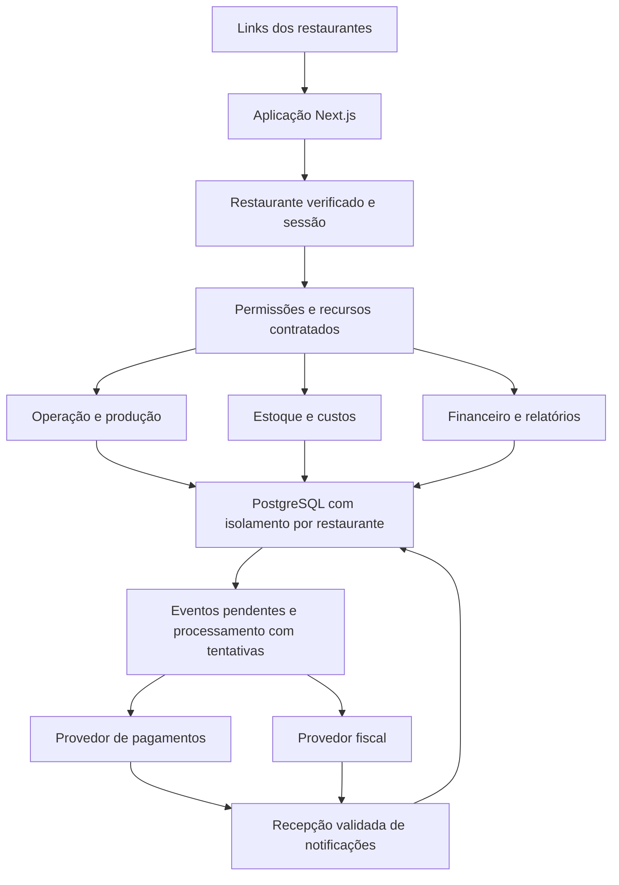
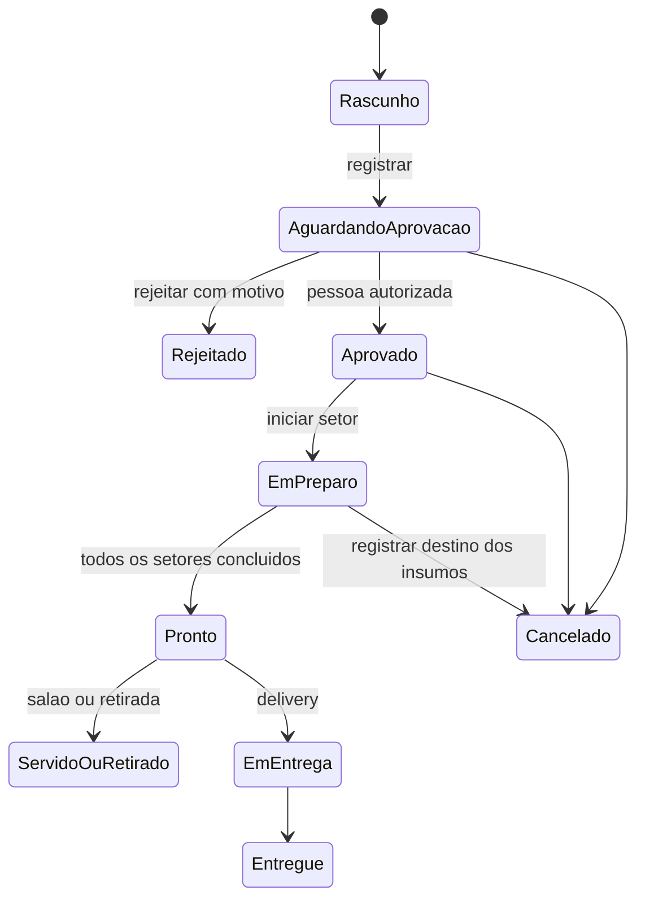

# Arquitetura do Gestor Food

Esta é a arquitetura proposta para evoluir o demonstrativo para um produto multiempresa. Ela descreve o destino completo e identifica os limites do primeiro MVP em [MVP e validação](MVP-E-VALIDACAO.md). Nomes de tabelas e rotas novas são contratos propostos, sujeitos a ajuste na implementação sem mudar as regras de negócio.

A execução começa pela [primeira versão do Patos como restaurante único](PRIMEIRA-VERSAO.md), incluindo o [piloto fiscal em MG](FISCAL-MG.md). Os componentes de domínio, múltiplos clientes e licenciamento descritos aqui pertencem à etapa seguinte; a criação do financeiro mantém desde já contexto de restaurante e referências compatíveis com essa evolução.

## 1 Base existente e mudanças necessárias

Leitura estática do checkout `4e02411`, realizada em 07/10/2026. Não equivale a teste de produção nem a inventário do schema realmente aplicado.

| Evidência local | Consequência para a evolução |
| --- | --- |
| `lib/restaurant-repository.ts`, `createOrder`, grava `confirmed`, baixa estoque e cria tickets | Introduzir aprovação no servidor e mudar os efeitos da criação |
| `RESTAURANT_SLUG = "patos-lanches"` no repositório | Resolver restaurante pela requisição e sessão, sem constante global |
| `lib/staff-session.ts` contém papel e pessoa, sem restaurante na sessão | Criar vínculo por estabelecimento, sessão revogável e validação em cada operação |
| `hasStaffSession` concede acesso geral ao papel `admin` | Separar proprietário do restaurante e administração da plataforma |
| `updateDeliveryStatus`, `updateKitchenTicket` e `setProductAvailability` têm operações por ID sem contexto explícito do restaurante | Corrigir antes de permitir clientes compartilhando o banco; não representa vazamento já comprovado |
| `cancelOrder` retorna todos os insumos consumidos | Diferenciar cancelamento antes do preparo, desperdício e devolução aproveitável |
| `closeTable` marca pedidos como `completed` ao receber | Separar fechamento financeiro da conclusão física da produção e entrega |
| `getOperationSnapshot` aplica `LIMIT 200` | Buscar todos os pedidos ativos em consulta própria; paginar histórico; agregar relatórios no banco |
| `stateFromSnapshot` monta vendas a partir de pedidos concluídos | Criar fatos de venda e datas financeiras próprias |
| `inventory_items` tem custo médio e receitas por variante | Reaproveitar e acrescentar custo histórico por item, rendimento e embalagem |
| `inventory_movements.unit_cost_cents` nem sempre preenchido na baixa por venda | Preservar custo no momento da movimentação |
| `drizzle.config.ts` aponta para SQLite, schema TypeScript vazio e SQL existente é PostgreSQL | Regularizar migrações sem gerar baseline vazio nem reaplicar SQL existente às cegas |
| Home e metadados ainda contêm marca fixa | Aplicar a identidade por restaurante em toda a experiência |
| Listagem de equipe em `/api/auth/team` é pública | Restringir identificação da equipe a dispositivo autorizado ou login adequado |
| Não há suíte de domínio/integração identificada nos arquivos do projeto | Criar testes de invariantes financeiros, concorrência e isolamento junto da implementação |

## 2 Estrutura geral

O produto será um monólito modular: uma aplicação implantável, com responsabilidades internas separadas. Isso permite transações consistentes entre venda, estoque e financeiro, aproveita o Next.js existente e evita administrar serviços distribuídos prematuramente.

Um repositório mantém código, migrações e testes. Um projeto principal Vercel atende os endereços cadastrados. Um banco Neon de produção mantém dados dos restaurantes. Neste piloto pré-operacional, usar o banco e o projeto atuais conforme orientação do proprietário, com testes identificados e preservação dos dados. Homologação fiscal é configuração do provedor. Depois do início comercial, reavaliar ambiente separado para evolução do software. Arquivos privados, como documentos fiscais e comprovantes, terão armazenamento privado e links temporários; não entram em diretório público do aplicativo.

Para o MVP, manter `pg`, SQL parametrizado, Zod e Route Handlers. Não trocar framework, ORM ou provedor de autenticação apenas para produzir a arquitetura. Manter polling operacional inicialmente, com consultas pequenas por papel e restaurante; avaliar notificações em tempo real quando houver medição de necessidade.

O modelo de aplicação compartilhada com domínios distintos é suportado pela [Vercel](https://vercel.com/docs/platforms). Domínio desconhecido deve resultar em erro controlado, nunca cair automaticamente no Patos.

## 3 Planos e recursos

Os planos são pacotes comerciais versionados, não cópias do software. A licença guarda a versão do pacote contratado, adicionais negociados e condições de manutenção; mudar o catálogo comercial não altera silenciosamente contratos já vendidos.

| Recurso | Essencial | Profissional |
| --- | --- | --- |
| Identidade, endereço, cardápio, preços e equipe próprios | Sim | Sim |
| Mesas, comandas, pedidos e aprovação | Sim | Sim |
| Cozinha, bar, retirada e entrega habilitáveis | Sim | Sim |
| Caixa por turno, formas de pagamento e conferência | Sim | Sim |
| Estoque básico, movimentações e receitas de produção | Sim | Sim |
| Vendas por período, produto e forma de pagamento | Sim | Sim |
| Custo e margem por produto e canal | Não no pacote padrão | Sim |
| Contas a pagar e receber, recorrência e parcelas | Não no pacote padrão | Sim |
| Contas financeiras, projeção de caixa e resultados | Não no pacote padrão | Sim |
| Conciliação manual assistida e conectores automáticos | Não no pacote padrão | Sim, conforme compatibilidade |
| Integração fiscal e exportações contábeis avançadas | Adicional a definir | Incluídas como capacidade, com ativação externa |
| Cardápio público e QR | Opcional | Opcional |

O núcleo registra fatos financeiros básicos nos dois planos. O Essencial precisa de recebimentos corretos e auditoria; o Profissional libera a gestão e análise avançadas desses fatos. Não ter o módulo fiscal contratado não elimina obrigações do estabelecimento; o cliente deve manter seu meio de emissão adequado até a integração estar ativa.

Recurso disponível = licença permite + recurso foi publicado + integração está configurada, quando exigida + usuário tem permissão. `finance.advanced`, `costing.analytics`, `reconciliation`, `fiscal.connector` e `accounting.export` são exemplos de chaves. Preferências visuais e operacionais não concedem licença nem permissão.

Upgrade habilita capacidades no mesmo restaurante, sem cópia de dados. Alteração para pacote menor preserva histórico e exportação conforme contrato; rotinas necessárias à integridade, como recebimento de retorno e processamento de estorno pendente, não param por ocultação do menu. Escopo de acesso após encerramento deve ser definido comercialmente.

## 4 Personalização de cada restaurante

Personalização abrange identidade e modo de operação, dentro de componentes mantidos pela plataforma. Presets visuais são ponto de partida; não contêm código específico para nomes de clientes.

| Camada | Configurações |
| --- | --- |
| Marca | Nome comercial, logo, ícone, capa, cores, tipografia de lista permitida, textos e contatos |
| Apresentação | Preset de layout, densidade, ordem de categorias, fotografias e destaque de produtos |
| Operação | Mesas, setores de preparo, horários, canais, taxa de serviço, fechamento do dia e regras de estoque |
| Cardápio | Variantes, adicionais, combos futuros, preços por canal e disponibilidade |
| Gestão | Metas próprias, categorias financeiras, contas e centros de custo |
| Integrações | Conta recebedora, emitente fiscal e credenciais exclusivas |

Exemplos ilustrativos: Patos com visual de lanchonete e preparo na chapa/cozinha; choperia com visual próprio, setores bar/cozinha, bebidas em ml e porções. Uma dose de 300 ml e um copo de 500 ml são variantes com consumo distinto. Perdas de chope são registradas como perdas, não como vendas. Controle por barril, tara e rendimento real é evolução específica, não funcionalidade já pronta.

Não aceitar JavaScript ou CSS arbitrário do cliente no MVP. Usar tokens e componentes configuráveis, preservar contraste e legibilidade. Prévia permite revisar a marca antes de publicar. Segredos nunca fazem parte da configuração enviada ao navegador.

## 5 Identidade e isolamento

O estabelecimento é a unidade de isolamento inicial. Um usuário pode pertencer a vários restaurantes por `restaurant_memberships`; a permissão é avaliada no vínculo, não no cadastro global da pessoa. Filiais com CNPJs próprios são restaurantes distintos no MVP. Um agrupamento futuro permite consolidação autorizada, sem remover essa fronteira.

Fluxo de uma requisição privada:

1. Normalizar o host e consultar o domínio registrado. Em desenvolvimento, permitir somente aliases locais previamente configurados.
2. Validar a sessão e localizar o usuário ativo. Sessões têm revogação e expiração, não apenas um papel assinado por 12 horas.
3. Validar vínculo ativo com o restaurante resolvido. Seleção de restaurante exige novo contexto autorizado.
4. Verificar permissão de ação e capacidade contratada no servidor.
5. Iniciar transação e estabelecer contexto do restaurante para as regras do banco.
6. Executar consultas e alterações com chaves vinculadas a esse restaurante, gravar auditoria e concluir a transação.

O navegador pode solicitar uma troca de restaurante, mas não estabelecer sozinho o contexto confiável. Rotas públicas têm contexto do host verificado e acesso limitado a dados públicos; criar pedido público não autentica cliente como funcionário.

Adicionar `restaurant_id NOT NULL` às entidades de negócio, inclusive filhas quando isso simplifica aplicação e auditoria das políticas. Usar chaves estrangeiras compostas `(restaurant_id, parent_id)` para impedir ligar pedido de A a produto, pagamento ou conta de B. Índices e unicidades incluem restaurante: número do pedido, domínio, referência de importação e identificadores externos conforme seu escopo.

Aplicar RLS com leitura e escrita restritas, inclusive `WITH CHECK`, conexão da aplicação sem privilégios de bypass e contexto transacional que não sobreviva ao retorno da conexão ao pool. Testar com o mesmo papel utilizado em produção. Sem contexto, negar acesso privado. Superusuários e donos de tabela podem contornar políticas se não configurados adequadamente; a [documentação do PostgreSQL](https://www.postgresql.org/docs/current/ddl-rowsecurity.html) descreve essas exceções.

Não compartilhar cache de respostas privadas. Cache de cardápio, temas e imagens inclui restaurante, versão e idioma quando aplicável. Jobs, exportações e notificações também levam contexto validado. O isolamento não termina na API síncrona.

## 6 Papéis e autenticação

| Papel | Autorizações propostas |
| --- | --- |
| Proprietário | Configuração do restaurante, equipe, módulos contratados e todo o financeiro local |
| Gerente | Operação e exceções delegadas; envio à cozinha somente quando também autorizado a atuar como garçom/caixa; acesso financeiro configurável |
| Garçom | Mesas/comandas, registrar e aprovar pedidos quando autorizado, servir itens |
| Cozinha ou bar | Tickets do setor; iniciar preparo e marcar pronto; sem dados financeiros ou endereço |
| Caixa | Aprovar pedidos, receber, operar turno, solicitar/realizar estornos conforme limite |
| Financeiro | Obrigações, liquidações, conciliação e relatórios, sem alterar licença |
| Entregador | Entregas atribuídas, endereço necessário e recebimento permitido |
| Contador | Consulta/exportação autorizada; sem criação de pagamentos nem alteração de pedidos |
| Operador da plataforma | Cadastro de clientes e suporte auditado; separado de proprietário local |

Proprietários e equipe administrativa usam credencial individual com recuperação e revogação. PIN rápido de equipe pode ser mantido em contexto de restaurante/dispositivo autorizado, com limitação de tentativas e bloqueio progressivo; não servirá como credencial global do financeiro. Detalhar biblioteca de autenticação na implementação, preservando fluxos existentes durante a transição.

Permissões explícitas: `orders.create`, `orders.approve`, `orders.cancel`, `kitchen.advance`, `cash.open`, `cash.receive`, `cash.close`, `refund.request`, `refund.approve`, `finance.read`, `finance.write`, `finance.settle`, `reports.export`, `settings.manage`. Desativar vínculo revoga sessões/acessos correspondentes. Acesso de suporte registra motivo, operador, restaurante e período.

## 7 Módulos e organização do código

| Módulo | Responsabilidade |
| --- | --- |
| `tenancy` | Domínios, restaurante ativo, identidade e configurações |
| `identity` | Usuários, vínculos, sessões, papéis e permissões |
| `licensing` | Planos versionados, licença e recursos habilitados |
| `catalog` | Produtos, variantes, adicionais, preços e setores |
| `orders` | Comandas, pedidos, aprovação, alterações e cancelamento |
| `production` | Tickets por setor, preparo e conclusão |
| `inventory` | Insumos, compras, recebimento, perdas e contagens |
| `costing` | Receitas versionadas, rendimento e custo histórico |
| `cash` | Gavetas/terminais, turnos, recebimentos e conferência |
| `finance` | Obrigações, contas, baixas, transferências e razão gerencial |
| `payments` | Intenções, transações, taxas, recebíveis e estornos |
| `reconciliation` | Extratos, correspondências e divergências |
| `fiscal` | Perfil tributário, tentativas, documentos e eventos |
| `reporting` | Consultas agregadas por período e exportações |
| `integrations` | Adaptadores externos, entradas de webhook e eventos de saída |
| `audit` | Histórico de ações e mudanças relevantes |

Estrutura proposta: `modules/<modulo>/{domain,service,repository,schemas}`; componentes em `components/<area>`; rotas HTTP continuam em `app/api`; infraestrutura em `lib/server`; testes em `tests/{domain,integration,e2e}`. Separar gradualmente `restaurant-repository.ts` e `restaurant-app.tsx` por fluxo, sem mover tudo em uma única alteração.

As rotas validam entrada e contexto, chamam serviços e traduzem erros. Serviços aplicam regras e delimitam transações. Repositórios executam SQL com contexto obrigatório. Componentes exibem resultados e comandam ações; não calculam o resultado financeiro oficial sobre arrays de pedidos recebidos.

## 8 Modelo de dados

Os nomes abaixo descrevem responsabilidades; não obrigam criar todas as tabelas antes do primeiro fluxo.

| Área | Entidades propostas e campos essenciais |
| --- | --- |
| Restaurante | `restaurants`: identidade, timezone, moeda BRL, fechamento do dia, situação; `restaurant_domains`: host normalizado, verificação; `restaurant_settings`: configuração versionada |
| Personalização | `restaurant_themes`: preset, tokens, referências de imagens, versão publicada |
| Acesso | `users`; `restaurant_memberships`; `sessions`; `role_permissions`; `device_authorizations` |
| Licença | `plan_versions`; `licenses`: pacote contratado, vigência do direito, condições; `feature_grants`: adicionais explícitos |
| Catálogo | Reaproveitar `menu_products`, `menu_variants`, `product_addons`; acrescentar setores e preços versionados por canal |
| Atendimento | `service_tabs`: comanda/visita e mesa; `orders`; `order_items`; `order_events`; revisão e idempotência |
| Produção | `order_approvals`; `kitchen_tickets`; `production_events`; unicidade por pedido, revisão e setor |
| Custos | `recipe_versions`; `recipe_components`; `order_item_cost_snapshots`: quantidades, custo, origem e cobertura |
| Estoque | Reaproveitar itens/movimentos; `purchase_receipts`, `purchase_receipt_items`, `inventory_counts`, `stock_dispositions` |
| Caixa | `cash_registers`, `cash_sessions`, `cash_movements`, `cash_counts`: responsável, abertura, fechamento e divergência |
| Financeiro | `financial_accounts`, `financial_categories`, `counterparties`, `financial_documents`, `financial_installments`, `settlements`, `settlement_allocations` |
| Razão gerencial | `journal_accounts`, `journal_entries`, `journal_lines`: lançamento, competência, origem, débito/crédito e reversão |
| Venda | `sales`, `sale_items`, `sale_order_allocations`: venda/comanda e itens efetivamente atendidos, descontos e repasses |
| Pagamentos | `payment_intents`, `payment_transactions`, `payment_allocations`, `payment_receivables`, `provider_payouts`, `refunds` |
| Conciliação | `statement_imports`, `statement_lines`, `reconciliation_matches`, `reconciliation_exceptions` |
| Fiscal | `fiscal_profiles`, `product_tax_profiles`, `fiscal_documents`, `fiscal_attempts`, `fiscal_events` |
| Integrações | `provider_connections`, `webhook_inbox`, `outbox_events`, `job_attempts`, `idempotency_requests` |
| Auditoria | `audit_events`, `report_exports`, `period_closures` |

Relações centrais: restaurante tem muitos vínculos e comandas; comanda tem vários pedidos; pedido tem itens, aprovações e tickets; venda consolida os itens atendidos; pagamentos se alocam à venda/conta; uma transação de cartão gera um ou vários recebíveis de repasse. Conta a pagar gera parcelas; uma baixa pode liquidar parte de uma ou várias parcelas. Um repasse pode quitar várias transações, por isso não usar relação fixa de um pagamento para um depósito.

Um pagamento parcial do consumidor é diferente de um recebível devido pela adquirente. Quando a adquirente assume a dívida de um cartão aprovado, o consumidor pode estar quitado e a adquirente ainda dever ao restaurante. Essa transferência de obrigação não cria uma segunda receita.

Invariantes de dados:

- Valores monetários em centavos inteiros, com limites seguros no TypeScript; quantidades e custos unitários fracionários em decimal de precisão definida. Não usar ponto flutuante para fechar saldos.
- Arredondamento determinístico por linha; sobras de centavos distribuídas de forma documentada em parcelas e rateios.
- Instantes em UTC; vencimento como data local; `business_date` e timezone do restaurante para o dia operacional.
- Lançamento efetivado é imutável; corrigir por reversão vinculada e novo lançamento. Cadastros usados no histórico são inativados, não apagados em cascata.
- Soma de alocações não supera saldo; débito total igual a crédito total por lançamento do razão; somente o serviço de lançamento pode efetivar um grupo balanceado.
- `idempotency_key` única no restaurante e na ação; armazenar hash da requisição e resposta. Reutilizar chave com outro conteúdo retorna conflito.
- `provider_event_id` único dentro de provedor, conexão e ambiente. Homologação e produção nunca compartilham referências sem diferenciação.
- Índices compostos por restaurante e data/status; histórico paginado, exportação completa por período e limites de uso controlados.

## 9 Aprovação e produção

Rascunho pode existir só na tela antes de enviar. Ao registrar, persistir estado pendente, itens e preços aceitos; não gerar ticket, venda ou baixa de estoque. O pendente aparece em central de aprovação para garçom/caixa autorizado, com canal e horário. A estimativa distingue espera de aprovação e produção.

A ação humana de aprovação se chama “Enviar para cozinha”. No atendimento presencial, o garçom ou caixa pode conferir a comanda e usar essa ação para registrar e aprovar na mesma requisição autenticada, com os dois eventos auditados e todos os efeitos dentro da mesma transação. Não é necessário impor dois cliques ao atendente. Salvar sem enviar ou receber pedido do canal do cliente mantém o estado pendente. A API pública nunca oferece o caminho de registro com aprovação; um campo enviado pelo cliente não pode selecionar esse comportamento.

Aprovar bloqueia a linha do pedido, valida versão e restaurante, revalida disponibilidade e permissões, congela receita/custo, registra autor e horário e gera tickets uma única vez. A numeração da fila de produção é atribuída nesse momento. Uma aprovação concorrente retorna o resultado existente ou conflito sem efeitos duplicados.

Para reaproveitar a base, o estoque pode ser baixado na aprovação, mas o valor permanece identificado como insumo destinado a produção até atendimento ou descarte. Antes do preparo, cancelamento permite devolução. Depois de iniciado, exigir destino real: perda, reaproveitamento autorizado ou devolução física. Nunca repor automaticamente comida já preparada.

Mudança de item pendente incrementa revisão. Adição a pedido aprovado gera nova rodada pendente; itens aprovados continuam com a revisão original. Não alterar quantidade já em produção silenciosamente. O MVP pode oferecer novo pedido na mesma comanda como forma explícita de acrescentar itens.

Pagamento e fiscal têm estados próprios. Cartão aprovado não substitui a aprovação operacional. Rejeitar pedido já pago cria obrigação de estorno, não apaga o pagamento.

## 10 Atendimento e fechamento

Mesa física e comanda são entidades distintas. Uma mesa pode receber outra visita depois de fechar, preservando a identificação da visita anterior. Numeração de pedido é do estabelecimento, sem sequência compartilhada com outros clientes.

No salão: abrir comanda, registrar pedidos, aprovar, produzir, servir, conferir conta, receber e encerrar. Uma pessoa pode pagar antes de todos os itens serem servidos; isso quita a conta, mas os tickets continuam na cozinha. O encerramento operacional exige atender ou cancelar os itens remanescentes.

Na retirada: registrar, aprovar, produzir, confirmar retirada; registrar pagamento antes ou no ato conforme configuração. No delivery: endereço validado, aprovação, preparo, saída e entrega; registrar devolução/falha de entrega e responsável. A entrega paga antes da saída permanece na fila até ser entregue.

Divisão por valor e múltiplas formas de pagamento entram no núcleo. Divisão por pessoa, transferência entre mesas, junção de comandas, combos e impressão são fluxos de evolução que mantêm alocações e auditoria; não usar edições diretas de totais para simulá-los.

## 11 Catálogo de fluxos e exceções

| Fluxo | Comportamento esperado | Destino |
| --- | --- | --- |
| Cadastrar cliente | Criar restaurante, domínio permitido, licença, configuração e proprietário atomicamente ou com retomada segura | MVP por comando de setup; painel posterior |
| Personalizar | Revisar prévia e publicar versão do tema; aplicar em login, operação, menu e metadados | MVP |
| Login e troca | Validar vínculo; limpar dados locais da empresa anterior | MVP |
| Equipe desativada | Revogar acesso mesmo com cookie ainda válido | MVP |
| Pedido de qualquer canal | Entrar pendente; dupla submissão não duplica | MVP |
| Aprovação concorrente | Um conjunto de tickets e uma baixa por revisão | MVP |
| Estoque insuficiente | Bloquear aprovação, indicar itens afetados e permitir revisão | MVP |
| Setores distintos | Cada setor recebe apenas seus itens; pronto somente após todos | MVP |
| Bebida sem preparo | Aprovação continua obrigatória; setor pode concluir imediatamente por ação autorizada | MVP simples |
| Cancelamento antes do preparo | Reverter destinação dos insumos uma vez, manter evento | MVP |
| Cancelamento depois do preparo | Registrar perda ou reaproveitamento real e eventual reembolso | MVP com ação gerencial |
| Pedido pago e não servido | Manter produção ativa e conta quitada | MVP |
| Pagamento parcial/misto | Alocar valor, manter saldo e separar troco | MVP |
| Pagamento excedente | Troco somente em dinheiro; excesso digital vira crédito/devolução identificada | MVP com tratamento explícito |
| Recusa/timeout de cartão | Estado pendente ou falha; consultar transação antes de reenviar | Integração posterior |
| Pagamento após cancelamento | Registrar crédito e pendência de devolução; nunca reabrir produção automaticamente | Integração posterior |
| Abrir/fechar caixa | Abertura, movimentos, contagem, diferença e responsável | MVP |
| Compra de insumos | Receber estoque e criar obrigação vinculada sem lançar duas despesas | MVP simples |
| Conta recorrente | Gerar parcelas por competência com chave única | Após núcleo de contas |
| Pagar/receber parcela | Baixa parcial/total, juros/desconto separado, evidência e conta | MVP |
| Transferir entre contas | Duas pontas na mesma transação; efeito consolidado zero | MVP |
| Conciliar extrato | Importar, detectar duplicados, sugerir correspondência, confirmar ou abrir divergência | MVP manual; importação na evolução |
| Reembolso/contestação | Eventos independentes, impacto em conta/recebível e histórico | Manual no MVP; automático posterior |
| Emissão fiscal | Validar perfil, enviar, acompanhar, guardar documento autorizado | Piloto MG, produção condicionada à validação |
| Rejeição fiscal | Exibir motivo, corrigir configuração e tentar novamente sem duplicar venda | Piloto MG |
| Falha da SEFAZ/provedor | Estado pendente/contingência suportada, fila e acompanhamento | Posterior, validar por UF/provedor |
| Fechar período | Conferir pendências, bloquear alterações retroativas, reabrir com autorização auditada | Evolução antes de uso contábil recorrente |
| Exportar contabilidade | Período, regime, versão e documentos; acesso restrito | CSV gerencial no MVP |
| Trocar plano | Preservar dados, atualizar recursos, não interromper retornos pendentes | MVP por setup; painel posterior |
| Restaurar cliente | Restaurar backup em ambiente auxiliar e recuperar somente dados autorizados | Procedimento antes de produção multiempresa |
| Sem conexão | Avisar e não declarar gravação confirmada; retomar consulta pela chave da operação | MVP online |
| Operação offline | Sincronização, conflitos e numeração próprios | Fora do primeiro MVP |

## 12 Contratos de API e navegação

Reaproveitar rotas existentes onde possível, delegando aos novos serviços. Não duplicar uma API antiga insegura e uma nova protegida. Todas as rotas privadas aplicam o mesmo resolvedor de contexto.

| Área | Rotas de interface propostas | Comandos HTTP principais |
| --- | --- | --- |
| Plataforma | `/plataforma/restaurantes` | Cadastro, licença, domínio e suporte |
| Aprovação | `/operacao/aprovacoes` | `POST /api/operations/orders/:id/approve`, `/reject` |
| Atendimento | Rotas atuais de garçom, caixa, cozinha e entregas | Comandas, atendimento de itens e transições |
| Caixa | `/operacao/caixa`, `/gestao/caixas` | `POST /api/cash/sessions`, `/movements`, `/:id/close` |
| Visão financeira | `/gestao/financeiro` | `GET /api/finance/summary?from=&to=&basis=` |
| Contas | `/gestao/financeiro/pagar`, `/receber`, `/contas` | Documentos, parcelas, baixas e transferências |
| Fluxo e resultado | `/gestao/financeiro/fluxo`, `/resultado` | Séries por dia e demonstrativo por competência |
| Margem | `/gestao/financeiro/produtos` | Custo e contribuição por produto/canal |
| Conciliação | `/gestao/financeiro/conciliacao` | Importações, propostas de vínculo e confirmação |
| Fiscal | `/gestao/fiscal` | Emissão, consulta e cancelamento autorizado |
| Contabilidade | `/gestao/contabilidade` | Exportações com acompanhamento |
| Integrações | `/gestao/integracoes` | Configuração, teste e ativação de conexão |

Escritas sensíveis recebem chave de idempotência e versão esperada quando houver edição concorrente. Erros distinguem sessão ausente, permissão, recurso não contratado, conflito de estado e falha temporária. ID de outro restaurante retorna resultado que não revela existência de dado privado.

Filtros de período usam limites inclusivo no início e exclusivo no fim, calculados no timezone local. A resposta traz totais, moeda, base de cálculo, cobertura de custos e atualização. Paginação não muda os totais do período. Exportação utiliza a mesma consulta e regras do painel.

## 13 Integrações e recuperação de falhas

Comandos locais de negócio gravam os efeitos e o evento de saída na mesma transação. Um processador busca os eventos pendentes, chama o provedor e registra tentativas, referência e resultado. Não fazer chamada lenta a provedor segurando lock de comanda ou caixa.

Receber webhook: verificar autenticidade pelo mecanismo do provedor, identificar conexão/ambiente, persistir evento com unicidade, responder rapidamente e processar de forma retomável. Consultar o estado canônico quando o evento for insuficiente ou fora de ordem. Estados não regridem por evento antigo.

Timeout após envio não significa falha definitiva: consultar pela referência antes de tentar nova cobrança ou emissão. Tentativas têm prazo, escalonamento, erro legível e ação de suporte. Jobs não vivem só na memória da Function; agendamento e mecanismo de execução durável serão selecionados na fase do primeiro conector.

Contratos dos adaptadores: pagamentos cria/consulta/cancela/reembolsa e lê liquidações; fiscal emite/consulta/cancela/obtém XML e documento auxiliar; extratos importam linhas normalizadas preservando dado original. Uma conexão é sempre específica do restaurante/emitente e ambiente.

## 14 Migração da base Patos

1. Conferir migrations aplicadas e schema real por leitura; mapear contagens e totais de controle. O SQL local não prova que todos os ambientes estão iguais.
2. Neste piloto, usar o banco atual autorizado pelo proprietário, com recuperação definida e testes identificados. Não executar reset global. Homologação fiscal usa ambiente do provedor separado logicamente por configuração.
3. Regularizar histórico de migrações com tabela de versão/checksum e baseline compatível. Não rodar `db:generate` atual esperando PostgreSQL.
4. Acrescentar estrutura multiempresa e preencher o restaurante existente em todas as relações legadas. Manter IDs e histórico.
5. Corrigir todas as consultas sem escopo, adicionar vínculos e sessões, chaves compostas e políticas; testar com dois restaurantes antes de habilitar segundo cliente.
6. Introduzir novos estados por expansão do schema e camada de compatibilidade. Pedidos legados confirmados recebem origem de aprovação legada, sem inventar autor humano ou recriar tickets.
7. Acrescentar o financeiro com marco de início explícito. Custos históricos ausentes ficam desconhecidos, nunca preenchidos retroativamente pelo custo atual como se fosse real.
8. Migrar pagamentos legados uma vez por referência, preservando seu caráter manual. Não converter automaticamente todo cartão antigo em recebível ainda aberto nem todo `paid_at` em liquidação bancária comprovada.
9. Comparar saldos, pedidos ativos, estoque e vendas antes/depois. Conferir em browser e no banco.
10. Registrar evidências das migrações no banco atual e distinguir desenvolvimento pré-operacional de liberação comercial. Nesta fase não haverá commit, push ou deploy; emissão fiscal real exige emitente configurado e operação real autorizada.

Preferir mudanças aditivas e compatíveis. Rollback de aplicação não elimina lançamentos novos; plano de retorno deve preservar dados e usar correção progressiva quando necessário.

## 15 Operação da plataforma

Logs com restaurante, ação, usuário, correlação e referência, sem segredos nem payloads pessoais completos. Acompanhar falhas de aprovação, divergência de caixa, demora de integração, webhooks rejeitados, fila acumulada e custo por cliente.

Backup e recuperação são requisitos do serviço. Antes de produção multiempresa, testar restauração em ambiente separado e recuperação seletiva; nunca voltar o banco compartilhado inteiro para resolver um erro de um só restaurante. Definir retenção, objetivo de perda máxima de dados e tempo de recuperação conforme plano contratado, sem promessa numérica ainda não testada.

Credenciais privadas criptografadas com chave fora do banco, rotação e permissão restrita. Nenhum número completo de cartão ou código de segurança é armazenado. Downloads financeiros/fiscais usam autorização e expiração. Exportação registra quem solicitou e o período.

Proteger escritas autenticadas contra requisições de origem indevida, aplicar limites de tentativas no login e de pedidos nos canais públicos e sanitizar uploads. Um erro de API retorna mensagem apropriada e referência de diagnóstico, sem SQL ou segredo. Limites de carga por restaurante evitam que exportação pesada ou abuso de pedidos monopolize o banco compartilhado.

Uma correção central pode afetar todos os clientes. Validar migrações em homologação, testar os dois planos e os dois presets, publicar gradualmente por recurso e manter diagnóstico por restaurante. Banco dedicado para cliente com necessidade especial é possível no futuro mantendo o mesmo código; não é o padrão do primeiro produto.
