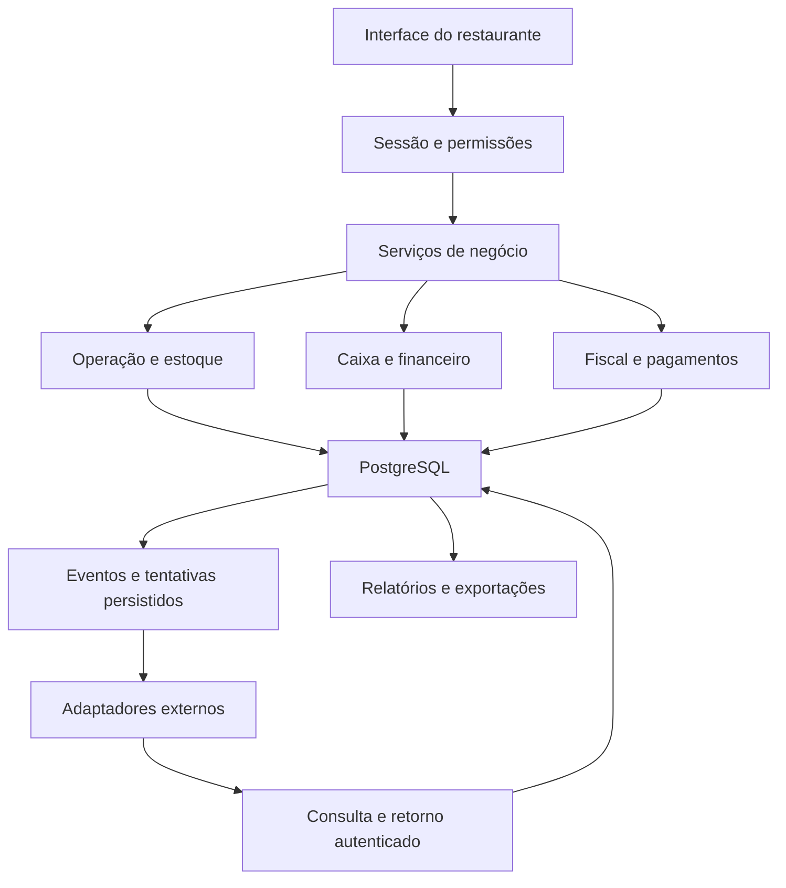

# Gestor Food produto completo e plano de implementação

Versão 1.2 • 9 de outubro de 2026 • Primeiro piloto em Minas Gerais • Alvo de avaliação no sábado 10 de outubro de 2026

Este é o documento mestre para transformar a base do Patos Lanches em um produto de operação e gestão de restaurantes, personalizável por estabelecimento, com planos Essencial e Profissional. Ele define o produto completo acordado até aqui e divide sua construção em blocos que podem ser implementados, testados pelo proprietário do produto e corrigidos antes da próxima entrega.

Sua função é ser o **manual do produto e contrato de escopo para desenvolvimento e validação**: visão, nome, marca, design, funcionalidades, regras, arquitetura, dados, integrações, operação, entregas e critérios de aceite. Uma implementação deve poder ser conferida contra esta base, e uma mudança de direção precisa ficar registrada nela.

**Estado atual: MVP 0.2 publicado em 09/10/2026, com verificação dirigida; aceite do usuário pendente.** A existência de um recurso neste documento não significa que ele está concluído. O recorte entregue, as evidências e todas as pendências estão em [Entrega local de 07/10/2026](ENTREGA-LOCAL-2026-10-07.md). O quadro da seção 19 foi atualizado; seu aceite permanece pendente. Fiscal real e integrações automáticas não estão disponíveis.

Este arquivo passa a ser a referência principal de escopo, sequência e aceite. Os documentos anteriores permanecem como apoio. Em caso de divergência, prevalecem a instrução mais recente do proprietário e sua incorporação neste documento. Mudanças futuras devem atualizar a versão, o bloco afetado e os testes, evitando manter duas definições concorrentes.

## 1 Como usar esta base de trabalho

1. Ler a definição do produto e as regras obrigatórias antes de alterar a aplicação.
2. Escolher o próximo bloco cujas dependências estejam resolvidas.
3. Implementar um fluxo completo, incluindo interface, servidor, persistência e tratamento de falha.
4. Executar a verificação técnica e entregar instruções reproduzíveis de teste.
5. O proprietário usa o sistema, relata erros, dificuldades, melhorias e funcionalidades que sentiu falta.
6. Classificar os relatos, corrigir bloqueadores e repetir os cenários afetados.
7. Registrar o resultado e avançar. Um recurso dependente não pode ser considerado concluído enquanto sua base estiver inconsistente.

O ciclo é **implementar → verificar → você testar → ajustar → registrar aceite**. A construção de outro bloco independente pode continuar durante seus testes, mas não deve esconder falhas nem alterar silenciosamente o cenário que você está avaliando.

### 1.1 Força das definições

| Classificação | Como interpretar |
| --- | --- |
| Decisão confirmada | Escolha explicitamente feita pelo proprietário na conversa; não mudar sem nova decisão |
| Definição de implementação | Solução proposta para cumprir o produto; pode ser refinada se preservar comportamento e aceite, com alteração registrada |
| Dependência externa | Requer acesso, contratação, configuração ou validação fora do código; não pode ser presumida concluída |
| Decisão pendente | Escolha comercial/fiscal/visual ainda não confirmada; usar hipótese identificada quando permitir avançar com segurança |
| Evolução | Faz parte do destino planejado, mas não do recorte inicial do piloto |

“Deve” indica requisito de aceite do escopo correspondente. “Pode” indica alternativa permitida. “Futuro”, “evolução” e “fica depois” não autorizam anunciar disponibilidade atual. Silêncio no teste não é aceite e ausência de relato não é prova de ausência de erro.

O manual fixa o produto conhecido, não torna imutáveis todas as escolhas antes do uso real. Seu feedback pode mudar prioridades e requisitos pelo procedimento da seção 19. Isso preserva a clareza do compromisso e permite melhorar o sistema sem retrabalho oculto.

### Navegação

| Seção | Uso |
| --- | --- |
| 2 a 4 | Visão do produto, decisões e ponto de partida |
| 5 a 7 | Planos, nome, personalização, pessoas, telas e contrato de design |
| 8 a 11 | Regras operacionais, financeiras, fiscais e integrações |
| 12 a 14 | Arquitetura, dados, segurança e qualidade |
| 15 | Mapa de dependências e blocos |
| 16 | Especificação executável dos blocos B00 a B15 |
| 17 a 19 | Plano até sábado, testes e rotina de feedback |
| 20 a 24 | Dependências externas, conclusão, fontes, histórico e glossário |

## 2 Definição do produto

Gestor Food é o nome provisório da plataforma. Patos Lanches é o primeiro estabelecimento atendido, com sua própria marca. Uma choperia ou outro restaurante terá identidade, cardápio, equipe, configurações e dados próprios, usando a mesma base mantida pela plataforma.

O produto deve organizar o trabalho desde o pedido até o atendimento, registrar os efeitos no estoque e no financeiro e dar ao proprietário informação confiável para tomar decisões. O dono precisa saber quanto vendeu, recebeu, gastou, tem a pagar, tem a receber e quanto cada produto contribui para pagar as despesas e formar resultado.

O produto completo inclui:

- Operação de salão, balcão, retirada e entrega, com cardápio digital opcional.
- Aprovação humana obrigatória antes de liberar pedidos para produção.
- Mesas, comandas, cozinha, bar, atendimento, entrega e cancelamentos auditados.
- Caixa por turno, recebimentos, troco, sangrias, suprimentos e fechamento.
- Insumos, entradas, fichas técnicas, custo histórico, perdas e inventário.
- Contas a pagar e receber, baixas, fluxo de caixa e resultado gerencial.
- Integrações de pagamento e conciliação para provedores explicitamente suportados.
- Emissão fiscal das vendas e entrega organizada dos documentos ao contador.
- Personalização, permissões e recursos por plano, sem duplicação do software.
- Gestão de vários restaurantes com isolamento de dados, domínios próprios, suporte e atualizações da mesma base.

“Completo” significa cobrir os fluxos definidos e suas falhas, com resultados verificáveis. Não significa integrar automaticamente qualquer banco, maquininha, impressora, sistema contábil ou operação tributária existente no mercado.

### 2.1 Resultado esperado para cada pessoa

| Pessoa | Resultado que o sistema precisa entregar |
| --- | --- |
| Proprietário do restaurante | Enxergar operação, caixa, obrigações, custos e resultado, podendo abrir os registros que explicam cada total |
| Garçom | Registrar corretamente, conferir, enviar para produção e acompanhar atendimento sem perder pedidos |
| Caixa | Receber sem duplicar, separar meios de pagamento, conferir o dinheiro físico e acompanhar documentos fiscais |
| Cozinha e bar | Ver apenas produção autorizada, organizada por setor, com alterações e cancelamentos claros |
| Entregador | Ver entregas atribuídas, endereço necessário, situação do pagamento e valores sob sua responsabilidade |
| Financeiro | Controlar vencimentos, baixas, saldos, taxas, repasses e divergências |
| Contador | Receber arquivos fiscais e relatórios identificados, completos e rastreáveis |
| Proprietário da plataforma | Implantar e manter novos clientes sem criar um fork de código para cada um |

### 2.2 Limites da visão atual

Folha de pagamento, escrituração contábil oficial, SPED, apuração tributária completa, reservas, fidelidade, marketplace de entregas, crédito próprio, Open Finance e operação inteiramente offline não são capacidades prometidas por esta versão da especificação. Poderão se tornar projetos próprios após definição de demanda, integração e custo.

Compras avançadas, importação de XML de fornecedores, controle por barril, combos, divisão por pessoa e recorrências financeiras estão descritos como evolução. Seu desenho não os transforma em requisitos do primeiro fim de semana.

## 3 Decisões e fronteiras do primeiro piloto

| Assunto | Decisão atual |
| --- | --- |
| Produto | Gestor Food, nome provisório; não renomear automaticamente o restaurante |
| Primeiro estabelecimento | Patos Lanches, em Minas Gerais |
| Infraestrutura | Reaproveitar GitHub, Next.js, Neon PostgreSQL e Vercel existentes |
| Ambiente de trabalho | Usar o projeto e banco atuais, pois o proprietário informou que a operação comercial ainda não começou |
| Preservação | Manter IDs, cadastros e histórico; nada de reset global para preparar a versão |
| Publicação | Instrução atual de 07/10: commits organizados e migrações autorizados; preparar localhost para teste do proprietário. Sem push ou deploy nesta etapa |
| Pedidos | Cliente solicita; garçom ou caixa autorizado decide enviar à cozinha |
| Pacotes | Essencial e Profissional, ambos personalizáveis |
| Piloto financeiro | Testar a capacidade Profissional no Patos, antes do portal comercial de planos |
| Fiscal do piloto | Emitir notas das vendas e exportar documentos para o contador |
| Fornecedor fiscal | Avaliar Focus NFe; nenhuma conta ou contratação está confirmada |
| Custo fiscal | Recorrência custeada pelo restaurante |
| Licença | Intenção de venda vitalícia; abrangência contratual e manutenção a definir |
| Parcelamento da licença | Até seis vezes é intenção negociável, não condição final confirmada |
| Expansão | Só cadastrar segundo restaurante real depois de validar isolamento multiempresa |
| Validação | Você testa cada bloco e devolve observações; aceite fica registrado |

Usar o banco atual não elimina a necessidade de conferir migrações, proteger dados e saber recuperá-los. Também não implica emitir notas reais em nome do restaurante durante testes de desenvolvimento. Homologação fiscal é um modo da integração e pode coexistir no mesmo banco com separação explícita de ambiente.

### 3.1 Três marcos diferentes

| Marco | Significado |
| --- | --- |
| Demonstração funcional | Fluxos selecionados funcionando com dados identificados; limitações visíveis |
| Piloto operacional do Patos | Operação, financeiro mínimo e obrigações fiscais do escopo real validados; pessoas e equipamentos preparados |
| Produto multiempresa completo | Piloto estabilizado, isolamento comprovado, planos aplicados, clientes implantáveis e conectores declarados testados |

O alvo de sábado é avaliar a chegada ao piloto operacional. A data não torna os critérios dispensáveis e não antecipa a conclusão do produto multiempresa completo.

## 4 Ponto de partida e lacunas conhecidas

Baseline local conferido na elaboração: `4e024119e15eb87090e495ccefbbbb9113135c35`. As verificações anteriores de GitHub/Vercel e das rotas públicas estão registradas em [Estado e melhorias](ESTADO-E-MELHORIAS.md), com data. Elas não substituem o teste dos novos fluxos.

| Área | Base identificada | Trabalho necessário |
| --- | --- | --- |
| Catálogo | Produtos, variantes, adicionais e imagens | Consolidar configurações e validar preços/disponibilidade no servidor |
| Identidade | Nome e imagens configuráveis em partes | Completar identidade do estabelecimento nas telas e metadados |
| Pedidos | Criação já confirma e produz efeitos | Separar solicitação de aprovação e liberar criação pelo caixa autorizado |
| Produção | Tickets e estados por setor | Garantir aprovação, concorrência e preservação de pedidos ativos |
| Pagamento | Registros manuais e fechamento | Separar quitação de conclusão física e integrar turno/financeiro |
| Delivery | Saída e entrega existentes | Preservar transições e integrar custódia de dinheiro |
| Estoque | Insumos, receitas e movimentos | Corrigir devolução no cancelamento e congelar custos |
| Gestão | Resumos sobre até 200 pedidos | Agregar todo o período no banco, com critérios explícitos |
| Sessões | Acesso por papel e sessão assinada | Revogação, permissões finas e futuro vínculo com restaurante |
| Migrações | SQL PostgreSQL com configuração Drizzle divergente | Reconciliar baseline antes de gerar/aplicar migrações |
| Financeiro avançado | Não identificado como módulo completo | Construir obrigações, baixas, razão, saldos e projeções |
| Fiscal e conciliação externa | Conectores novos não implementados | Desenvolver integração e validar com provedor |
| Vários clientes | Restaurante fixo em pontos do código | Retirar dependências do nome e validar fronteira de dados |

Esse levantamento serve para direcionar B00. Não autoriza presumir que todo comportamento antigo está correto nem reescrever a aplicação inteira antes de entregar um fluxo.

## 5 Planos e modelo comercial

### 5.1 Matriz do produto final

| Capacidade | Essencial | Profissional |
| --- | --- | --- |
| Marca, cardápio e configurações próprias | Incluída | Incluída |
| Mesas, comandas, aprovação e produção | Incluída | Incluída |
| Retirada e delivery habilitáveis | Incluída | Incluída |
| Caixa, recebimentos e fechamento | Incluída | Incluída |
| Estoque básico e receita operacional | Incluída | Incluída |
| Histórico e relatórios de vendas | Incluída | Incluída |
| Cardápio digital e QR Code | Opcional | Opcional |
| Contas a pagar e receber | Fora do pacote padrão | Incluída |
| Fluxo realizado e projetado | Resumo básico do caixa | Incluída a gestão avançada |
| Custo histórico e contribuição por produto | Sem painel avançado | Incluída |
| Resultado gerencial e fechamento de período | Fora do pacote padrão | Incluída |
| Conciliação assistida e automática | Fora do pacote padrão | Incluída para integrações compatíveis |
| Integrações de pagamento | Escopo comercial a definir | Capacidade prevista, por provedor suportado |
| Fiscal | Adicional ou inclusão ainda a decidir | Capacidade incluída; serviço externo pago pelo cliente |
| Exportação contábil avançada | Vendas e dados contratuais | Financeiro e pacote fiscal conforme módulos ativos |

Esta é a matriz proposta com base nas decisões atuais. Fiscal no Essencial e cobertura comercial dos conectores ainda precisam de decisão antes de proposta ao cliente. Não usar ausência de um módulo contratado para sugerir que o estabelecimento está dispensado de cumprir suas obrigações.

### 5.2 Como os planos funcionam no sistema

Plano não é banco, aplicação ou branch separados. Guardar uma versão do pacote contratado e concessões adicionais por restaurante. A API confere quatro condições: recurso publicado, licença permite, integração configurada quando necessária e usuário autorizado.

Upgrade habilita menus e ações na mesma base, preservando dados. Redução de plano preserva histórico e não abandona estornos, notificações ou documentos pendentes. Acesso e exportação após encerramento devem obedecer às condições comerciais definidas. Uma falha temporária do serviço fiscal não apaga a licença adquirida.

### 5.3 Licença e serviços recorrentes

A intenção de licença vitalícia precisa definir direito de uso, versão, módulos, número de estabelecimentos, suporte, atualizações, correções e condições de hospedagem. Licença e prestação continuada de serviço são registros separados. A venda da licença não deve ser misturada às refeições vendidas pelos restaurantes.

R$ 2.400 e R$ 4.500 são referências anteriores, ainda não preços finais aprovados. Parcelamento, taxas, juros e líquido recebido dependem da contratação comercial. Não é necessário implantar checkout da plataforma para validar o piloto; a ativação pode ser feita por procedimento administrativo auditado.

Antes de comercializar, calcular implantação, treinamento, hospedagem, banco, armazenamento, backup, suporte e manutenção de integrações. Fiscal terá custo do restaurante. A responsabilidade pelas demais despesas recorrentes permanece aberta e precisa ser refletida no contrato.

## 6 Personalização sem versões divergentes

| Dimensão | Configuração permitida | Regra |
| --- | --- | --- |
| Marca | Nome, logo, ícone, capa, cores, contatos e textos | Identidade do cliente não altera regras de negócio |
| Apresentação | Preset, densidade, fotografias e ordem de categorias | Componentes e tokens mantidos pela plataforma |
| Operação | Mesas, setores, canais, horários e fechamento do dia | Configuração versionada com valores válidos |
| Cardápio | Produtos, variantes, adicionais, disponibilidade e preços | Histórico de vendas mantém o preço original |
| Gestão | Categorias, contas, metas e centros de custo | Indicadores usam a classificação registrada |
| Fiscal e pagamentos | Emitente, conta recebedora e provedor | Segredos exclusivos, somente no servidor |
| Endereço | Subdomínio ou domínio próprio verificado | URL identifica contexto; login autoriza acesso |

Patos pode ter um visual de lanchonete e choperia outro visual, com bar e cozinha separados. Bebida de 300 ml e 500 ml são variantes com consumos distintos. Recurso específico deve virar configuração ou módulo reutilizável quando fizer sentido, não código espalhado testando o nome do cliente.

Não permitir JavaScript arbitrário em configurações. Prévia de marca deve preservar contraste, legibilidade, estados de erro e uso no celular. A marca Gestor Food aparece onde fizer sentido comercial; a operação mostra claramente o restaurante ativo.

## 7 Pessoas e mapa de telas

### 7.1 Papéis e ações

| Papel | Pode fazer | Limite padrão |
| --- | --- | --- |
| Proprietário | Configurar equipe, operação, financeiro e integrações locais | Não administra outros restaurantes |
| Gerente | Operação e exceções delegadas | Financeiro e envio à cozinha dependem das permissões atribuídas |
| Garçom | Comandas, registro, envio autorizado e serviço | Sem extratos, custos globais ou segredos |
| Caixa | Envio autorizado, recebimentos e turnos | Estorno/desconto seguem alçada |
| Cozinha ou bar | Tickets do setor, preparo e pronto | Sem endereço do cliente e financeiro |
| Entregador | Entregas atribuídas e recebimento autorizado | Sem outras entregas/dados de gestão desnecessários |
| Financeiro | Contas, baixas, fluxo, repasses e relatórios | Sem licenciamento da plataforma |
| Contador | Consulta e exportação permitidas | Sem alterar pedidos ou movimentar dinheiro |
| Suporte da plataforma | Diagnóstico e suporte com motivo e registro | Sem acesso irrestrito silencioso |

Pessoa, papel e restaurante são dimensões distintas. Desativar uma pessoa/vínculo deve interromper seu acesso, inclusive em sessão já aberta. PIN rápido pode atender operação em contexto autorizado, mas não ser a única proteção de configurações fiscais e gestão sensível.

### 7.2 Navegação funcional

Rotas abaixo são propostas; preservar endereços existentes quando possível e redirecionar mudanças necessárias.

| Área | Telas | Conteúdo e ações principais |
| --- | --- | --- |
| Acesso | Login e recuperação | Restaurante, pessoa, sessão e mensagens de falha claras |
| Início | Resumo por papel | Próximas ações e pendências relevantes, sem expor gestão à cozinha |
| Atendimento | Mesas, comandas e novo pedido | Itens, observações, preços, totais e envio à cozinha |
| Aprovação | Pedidos pendentes | Origem, espera, revisão, aprovar/rejeitar e motivo |
| Produção | Cozinha e bar | Fila autorizada, tempo, setor e avanço de estado |
| Retirada | Pedidos prontos | Identificação, pagamento e confirmação de retirada |
| Entregas | Atribuídas, em rota e histórico | Endereço, responsável, saída, entrega e custódia |
| Caixa | Turno e recebimentos | Abertura, conta, formas de pagamento, sangria e fechamento |
| Catálogo | Produtos, categorias e adicionais | Cadastro, imagem, variante, setor e disponibilidade |
| Estoque | Insumos, entradas e inventário | Quantidades, custo, perdas e movimentos |
| Custos | Fichas técnicas e análise | Rendimento, unidades, custo atual e histórico |
| Financeiro | Contas, pagar, receber e movimentações | Vencimentos, baixas, transferências, anexos e reversões |
| Fluxo | Realizado e previsto | Saldos, entradas, saídas, contas e horizontes |
| Resultados | Vendas, contribuição e demonstrativo | Período, cobertura, composição e exportação |
| Fiscal | Configuração, pendências e documentos | Emissão, consulta, arquivos, cancelamento e pacote |
| Conciliação | Importações, sugestões e divergências | Conferência e evidências de repasses |
| Configurações | Marca, operação, equipe e integrações | Permissões e alterações auditadas |
| Plataforma futura | Clientes, planos e suporte | Implantação, domínios, concessões e diagnóstico |

Toda tela de consulta precisa de carregamento, vazio, sucesso, erro e falta de permissão. Toda mutação deve informar o resultado verdadeiro e permitir recuperar o trabalho quando a conexão cair. Valores monetários devem permanecer legíveis em 360, 390 e 430 px, além do desktop.

### 7.3 Nome marca e linguagem do produto

| Elemento | Definição |
| --- | --- |
| Nome da plataforma | Gestor Food, provisório conforme decisão atual |
| Nome do piloto | Patos Lanches; preservar cadastro e grafia configurada no restaurante |
| Nome dos planos | Essencial e Profissional |
| Descrição funcional | Operação e gestão para restaurantes |
| Título no aplicativo do cliente | Nome do restaurante seguido da área, por exemplo Patos Lanches — Caixa |
| Logo da plataforma | Identidade própria ainda não desenhada/aprovada; não inventar aprovação visual |
| Logo do cliente | Arquivo autorizado/configurado para o restaurante; manter proporção e área de respiro |
| Endereço público futuro | Host cadastrado e verificado; domínio definitivo ainda não escolhido |
| Marca em documentos fiscais | Dados do emitente e conteúdo do documento; não substituir razão social por nome da plataforma |

Giro Food e outras alternativas mencionadas não foram escolhidas. Não renomear código, banco, domínio ou conta de provedor em função de sugestão de nome. Disponibilidade de marca/domínio deverá ser verificada antes de uma adoção comercial definitiva.

Usar português brasileiro, moeda BRL com vírgula decimal, datas legíveis e verbos diretos. Termos preferidos: “Enviar para cozinha”, “Registrar recebimento”, “Confirmar retirada”, “Saiu para entrega”, “Baixar conta”, “Fechar caixa”, “Consultar nota” e “Exportar para o contador”. Explicar “baixa” na tela financeira como registro de pagamento/recebimento; não usar a palavra para sugerir quitação de tributo.

Evitar jargões como tenant, webhook, idempotência e payload nas telas de operação. Mensagem de erro deve dizer o que aconteceu, se a ação foi gravada e qual o próximo passo possível. Não usar “Tudo certo” quando somente o envio foi aceito e ainda falta autorização.

### 7.4 Direção visual

O design deve evoluir a base atual: superfícies claras, texto escuro, destaque moderado da marca, cartões legíveis e boa densidade operacional. A gestão prioriza leitura de valores; a operação prioriza ação rápida e identificação de estado. Não substituir a interface inteira por um conceito novo antes de validar o trabalho existente.

Leitura do CSS atual identificou fundo claro próximo de `#F4F4EF`, texto `#171814`, cartões brancos, destaque lima `#D7FF55` e pilha tipográfica Inter/system-ui. Esses valores são referência de continuidade visual, não identidade obrigatória de todos os clientes. O aplicativo publicado não foi reavaliado visualmente nesta etapa documental.

O contrato visual abaixo é a **definição proposta para implementação e teste**. Os valores podem ser ajustados no primeiro bloco visual mediante seu feedback, preservando hierarquia, estados, acessibilidade e consistência.

| Token ou padrão | Referência inicial | Uso |
| --- | --- | --- |
| Fundo de aplicação | `#F4F4EF` ou neutro equivalente do tema | Área externa ao conteúdo |
| Superfície | `#FFFFFF` | Formulários, listas e cartões |
| Texto principal | `#171814` | Valores, rótulos e títulos |
| Texto secundário | Cinza escuro com contraste validado | Contexto e observações, sem esconder avisos |
| Ação principal | Escuro da base ou cor de marca validada | Uma ação dominante por contexto |
| Destaque de marca | Lima atual como referência do Patos; configurável | Identidade, seleção e detalhes, não estado financeiro |
| Sucesso | Verde com ícone e texto | Ação efetivada e estado concluído |
| Atenção | Âmbar com ícone e texto | Pendência/espera, sem depender só de cor |
| Erro ou risco de perda | Vermelho com texto objetivo | Falha, rejeição e ação destrutiva |
| Informação | Azul ou neutro distinto | Contexto e orientações |
| Espaçamento | Escala de 4, 8, 12, 16, 24 e 32 px | Alinhamento e consistência |
| Cantos | Aproximadamente 12 px em controles e 16 px em cartões | Continuidade com a base, sem excesso de decoração |
| Tipografia | Inter quando disponível; fallback system-ui | Uma família principal e números tabulares em valores |
| Corpo e controles | Referência de 16 px para formulários; 14–16 px para listas | Leitura e toque no celular |
| Títulos | Hierarquia aproximada 24–32 px, 20–24 px e 16–18 px | Não competir com os valores da operação |
| Área de toque | Alvo mínimo de projeto de 44 × 44 px | Ações operacionais e ícones interativos |
| Movimento | Curto e discreto; respeitar redução de movimento | Nunca bloquear ação ou sinalizar sucesso fictício |

Imagem de produto não substitui nome, preço e disponibilidade. Não aplicar contraste fraco para combinar com uma marca. Logotipo não pode ocupar o espaço de operação necessário no celular. Tema escuro global é evolução; painéis de produção podem ter preset específico se validado na rotina.

### 7.5 Estrutura das telas e navegação

**Desktop de gestão:** navegação lateral por áreas, cabeçalho com restaurante/usuário, título com ação principal, filtros próximos do conteúdo e alertas relevantes acima da lista. Conteúdo de gestão pode usar largura confortável, mantendo tabelas legíveis; não dispersar números relacionados em extremos da tela.

**Operação:** atalhos por papel. Garçom entra em mesas/pedidos; cozinha no setor; entregador nas suas entregas; caixa no turno e contas. Não obrigar equipe a atravessar dashboard financeiro para iniciar uma tarefa.

**Celular:** substituir barra lateral por navegação compacta com até quatro destinos principais por papel e acesso às demais áreas. Ação principal pode ficar fixa na parte inferior, respeitando teclado e área segura. Não usar ação fixa que cubra total, confirmação ou mensagem de erro.

**Detalhe de registro:** mostrar identificação, estado, valores, origem e histórico. Ações de exceção ficam separadas da rotina. Voltar deve preservar filtro, posição de lista e rascunho quando apropriado. Mudança de restaurante limpa contexto anterior antes de carregar conteúdo novo.

### 7.6 Composição das telas principais

| Tela | Ordem de informação | Ação principal | Estado vazio ou pendência |
| --- | --- | --- | --- |
| Visão do proprietário | Período → vendas/recebimentos/resultado → vencimentos/caixa → contribuição → composição | Abrir detalhe do indicador ou registrar obrigação | Explicar ausência de movimento ou cobertura insuficiente |
| Mesas | Setor/filtro → mesa → comanda/saldo → andamento | Abrir comanda ou adicionar pedido | Mesa disponível, sem fingir conta aberta |
| Novo pedido | Comanda/canal → busca/categorias → itens/adicionais → resumo | Enviar para cozinha para atendente autorizado | Indicar item necessário, indisponibilidade e preço alterado |
| Pendentes | Espera/origem → itens/observações → revisão → ações | Conferir e enviar | “Nenhum pedido aguardando aprovação” |
| Cozinha e bar | Fila → tempo → mesa/canal → itens → estado | Iniciar preparo ou marcar pronto | Sem pedidos aprovados; exibir conexão/atualização |
| Caixa | Situação do turno → conta → valor devido → meios → conferência | Registrar recebimento | Abrir caixa antes de receber quando exigido |
| Pagar e receber | Vencidos/a vencer → filtros → lista → detalhes | Registrar conta ou baixa | Oferecer cadastro sem inventar previsão |
| Fluxo de caixa | Saldo/data → realizado/previsto → curva/tabela → composição | Abrir os movimentos do dia | Explicar previsões sem vencimentos cadastrados |
| Produto e custo | Venda/preço → ficha atual → custo → histórico → cobertura | Editar ficha ou consultar venda | “Ficha incompleta” com os campos faltantes |
| Fiscal | Ambiente/emitente → pendências → documentos → detalhe | Emitir quando elegível ou consultar resultado | Bloqueio de configuração com requisitos claros |
| Exportação | Escopo/período → quantidade → pendências → arquivos | Gerar pacote ou baixar | Nenhum documento no período, sem ZIP enganoso |

Visão de referência para o financeiro no desktop:

```text
Restaurante                       Período e dia operacional
Vendas atendidas | Recebimentos | Pagamentos | Saldo disponível
Resultado gerencial e cobertura dos custos
Fluxo de caixa previsto            Contas vencidas e a vencer
Contribuição por produto           Pendências de conciliação e fiscal
Composição detalhada do indicador selecionado
```

No celular, a ordem permanece, com blocos empilhados e valores completos. Gráfico é acompanhado de tabela/valor; não obrigar o usuário a interpretar uma curva para descobrir o saldo.

### 7.7 Componentes e interações

**Botões:** ação principal, secundária e destrutiva distinguíveis. Durante envio, mostrar processamento e impedir clique repetido, mantendo idempotência no servidor. Ação indisponível tem motivo visível. Ícone sem texto recebe nome acessível.

**Formulários:** rótulo permanente, indicação de obrigatório, ajuda ao lado do campo e erro específico. Preservar campos digitados após falha recuperável. Valores em reais têm entrada controlada e conversão explícita a centavos; quantidades aceitam a precisão da unidade. Não permitir salvar NaN, valor inválido ou data impossível.

**Listas e tabelas:** cabeçalho claro, valores alinhados à direita, totais identificados e paginação. No celular, priorizar colunas essenciais ou cartões; rolagem horizontal fica reservada a tabelas analíticas que realmente precisam dela, nunca a toda a página.

**Filtros:** período visível, limpar filtros, indicação de filtros ativos e estado vazio diferente de erro. Abrir uma venda do relatório deve preservar os mesmos critérios ao voltar.

**Modais e painéis laterais:** usar para tarefa curta contextual. Formulários longos ocupam página ou painel adequado ao celular. Foco entra no diálogo, fica controlado e retorna ao acionador. Esc não descarta silenciosamente dado importante; confirmar descarte quando necessário.

**Avisos:** confirmação transitória complementa o estado persistido; não é a única evidência de que um recebimento foi salvo. Pendência fiscal ou saldo divergente continua visível até resolução. Notificações sonoras na cozinha são opcionais e não substituem sinalização visual.

**Ações sensíveis:** cancelamento, reversão, alteração de saldo inicial, fechamento e emissão real mostram consequência e contexto. Evitar confirmação extra para toda ação cotidiana. Confirmação de interface é regra do produto, distinta de pedir autorização no chat para cada alteração de código.

### 7.8 Estados de interface obrigatórios

| Estado | Comportamento |
| --- | --- |
| Carregando | Estrutura estável e indicação de espera; sem valores falsos como se fossem zero |
| Sem dados | Explicar ausência e próxima ação útil |
| Erro de leitura | Informar falha, preservar contexto e permitir tentar novamente |
| Gravando | Indicar ação em andamento e impedir duplicação de clique |
| Gravado | Exibir identificador/estado atualizado e valor persistido |
| Resultado desconhecido | Informar consulta em andamento; não mandar reenviar às cegas |
| Sem permissão | Explicar acesso indisponível sem revelar conteúdo privado |
| Recurso não contratado | Comunicar disponibilidade comercial sem expor dados de outro plano |
| Integração não configurada | Mostrar requisitos faltantes; não apresentar botão que simula sucesso |
| Offline ou leitura desatualizada | Exibir última atualização; não afirmar gravação no servidor |
| Conflito de versão | Recarregar registro e explicar alteração por outro operador |
| Custo ou relatório parcial | Identificar lacunas junto ao número e permitir abrir a composição |

### 7.9 Design por estabelecimento e por papel

Marca muda tokens e imagens, não o significado das cores de erro, os nomes dos estados ou os controles de segurança. Papéis podem mudar atalhos, densidade e dados visíveis. Cozinha favorece leitura à distância; atendimento favorece toque; gestão favorece comparação de números.

O primeiro preset deve funcionar bem para o Patos. A choperia acrescentará seu preset e configuração de bar sem duplicar componentes. Novo preset precisa passar pelo mesmo roteiro mobile, contraste e estados de erro.

### 7.10 Aceite visual

- Ação principal da tarefa é localizável sem explicação externa.
- Nome do restaurante, conta, pedido e contexto de operação são inequívocos.
- Nenhum valor, botão ou erro essencial fica cortado em 360, 390 e 430 px.
- Zoom, navegação por teclado e foco visível preservam acesso aos comandos.
- Texto/ícones explicam estados sem depender exclusivamente de cor.
- Longos nomes, observações e valores grandes não quebram o layout.
- Filtros, carregamento, vazio, falha e sucesso foram usados em teste real.
- Dados permanecem corretos após recarga; animação ou tela pronta não conta como funcionalidade.
- A marca do cliente é reconhecível sem comprometer legibilidade.
- Sua avaliação de clareza e fluidez está registrada junto às correções solicitadas.

Não há mockup aprovado nem identidade visual definitiva da plataforma nesta etapa. Este contrato de design é a base para construir e avaliar as telas; capturas da implementação validada devem ser anexadas à evidência de cada bloco visual.

## 8 Regras da operação

### 8.1 Estados independentes

Não usar um único campo para representar produção, recebimento, repasse e fiscal. Uma entrega pode estar paga e ainda em preparo; uma venda pode estar atendida e com cartão a receber; uma nota pode estar rejeitada sem que isso apague o recebimento.

| Dimensão | Estados de negócio previstos |
| --- | --- |
| Solicitação | Rascunho, aguardando aprovação, aprovada, rejeitada ou cancelada |
| Produção | Não liberada, na fila, em preparo, pronta, interrompida/cancelada |
| Atendimento | Aguardando, servido/retirado; no delivery, pronto, em entrega, entregue ou falha |
| Consumidor | Em aberto, parcialmente pago, pago, devolução pendente, parcialmente devolvido ou devolvido |
| Repasse | Previsto, parcial, liquidado, bloqueado ou divergente |
| Fiscal | Não solicitado, configuração pendente, envio pendente, resultado desconhecido, autorizado, rejeitado, cancelamento pendente ou cancelado |

Os nomes técnicos e a migração de enums serão definidos sem alterar esses significados. “Finalizado” na interface deve indicar qual dimensão está concluída.

### 8.2 Do pedido à produção

Cliente solicita → pedido aguarda conferência → garçom/caixa aciona **Enviar para cozinha** → servidor valida → tickets entram nos setores → preparo → pronto → atendimento.

No canal público, gravar pendente sem ticket nem consumo. No lançamento presencial, o atendente pode registrar e aprovar em uma única ação explícita e transação, preservando eventos de registro e aprovação. “Salvar” sem enviar não produz. Pagamento online também não substitui a aprovação.

A aprovação valida identidade, permissão, restaurante, revisão, itens, disponibilidade, preço aceito e regra de estoque. Congela preço, componentes e custo conhecido, registra pessoa/horário e gera efeitos uma única vez. Falha em qualquer etapa não pode deixar metade dos tickets criada.

Pedido pendente pode ser revisado. Alteração após aprovação não reescreve silenciosamente o que está em produção. No piloto, acréscimos podem ser um novo pedido na mesma comanda. Retirada/cancelamento de itens aprovados registra motivo, alerta o setor e trata estoque e financeiro separadamente.

### 8.3 Mesas e comandas

Mesa é o local; comanda é a conta/visita; pedido é uma rodada de itens. Fechar uma visita não altera visitas anteriores. Uma comanda pode ter vários pedidos e vários pagamentos. Saldo a pagar deriva das alocações, não de um total editável sem origem.

Salão: abrir comanda, lançar, aprovar, produzir, servir, receber e encerrar. Recebimento antecipado é permitido quando configurado, mas não remove tickets. Encerrar operacionalmente exige tratar todos os itens e resolver o saldo ou transferi-lo explicitamente para obrigação autorizada.

Divisão por valor e múltiplas formas entram no núcleo. Divisão por pessoa, juntar comandas e transferir mesa ficam no B15, com alocações auditáveis. Desconto registra valor, motivo, autor e distribuição; gorjeta/taxa de serviço fica separada e depende da configuração do estabelecimento.

### 8.4 Retirada e delivery

Retirada exige identificação suficiente, pedido pronto e confirmação do atendimento. Delivery valida dados de entrega, taxa e responsável. Preservar a sequência `ready → out_for_delivery → delivered`; não concluir diretamente uma entrega que ainda não saiu. Falha de entrega registra motivo e destino dos produtos e do pagamento.

Endereço aparece para quem precisa entregar e administrar o atendimento, não no painel de cozinha. Dinheiro recebido pelo entregador permanece sob sua custódia até prestação de contas. A transferência ao caixa não é outra venda.

### 8.5 Cancelamentos e exceções

| Situação | Tratamento |
| --- | --- |
| Pendente rejeitado | Motivo e histórico; nenhum ticket/consumo |
| Aprovado ainda sem preparo | Interromper tickets e devolver somente quantidades elegíveis |
| Já em preparo | Registrar perda, reaproveitamento autorizado ou devolução física real |
| Já pago | Criar pendência/reembolso; não apagar pagamento |
| Nota autorizada | Tratar evento fiscal separado conforme regra aplicável |
| Item indisponível | Impedir aprovação inválida e oferecer revisão explícita |
| Duas pessoas aprovam | Um conjunto de efeitos; segunda recebe resultado existente ou conflito |
| Dois setores concluem | Estado agregado correto mesmo com ações simultâneas |
| Pedido antigo ativo | Continua visível mesmo depois de centenas de pedidos novos |
| Conexão cai após ação | Consultar resultado antes de repetir; sem duplicação |

## 9 Financeiro e indicadores

### 9.1 Datas e origem dos valores

Guardar data de registro, aprovação, atendimento, competência, vencimento, pagamento, liquidação e dia operacional quando aplicáveis. Instantes são armazenados em UTC; datas de vencimento e cortes usam o fuso do restaurante. A virada da meia-noite não deve encerrar um turno implicitamente.

Política gerencial proposta: receita e CMV dos itens são reconhecidos quando servidos, retirados ou entregues. Até lá, recebimento é adiantamento e material separado para preparo é produção em andamento. O momento fiscal segue a operação e a regra validada, não é inferido dessa política gerencial.

O núcleo usa um razão gerencial de lançamentos balanceados: soma dos débitos igual à dos créditos. Ele não substitui a contabilidade oficial. Uma correção gera reversão ligada ao original. Vendas, obrigações, baixas e saldos devem ser conciliáveis pelas mesmas origens.

### 9.2 Caixa operacional

Gaveta/terminal tem um turno aberto por vez, responsável e abertura explícita. Registrar fundo, recebimentos, troco, suprimento, sangria, despesas autorizadas, contagem e diferença. Fechamento deve impedir recebimento concorrente no turno já encerrado.

`esperado físico = fundo + recebimentos em espécie − troco + suprimentos − sangrias − despesas em espécie − reembolsos em espécie`

Pix e cartão aparecem no resumo, mas não aumentam dinheiro na gaveta. Fundo vindo do cofre é transferência; não criar receita a cada abertura. Diferença é contado menos esperado e nunca justifica editar pagamentos antigos para “fechar”.

### 9.3 Contas e obrigações

Contas financeiras: caixa, cofre, banco, saldo disponível em provedor e custódia de entregador. Recebíveis de clientes/adquirentes são separados do dinheiro disponível. Categorias dizem a natureza; centros de custo podem indicar operação/canal na evolução.

Documento a pagar/receber contém contraparte, descrição, origem, categoria, valor, competência, vencimento, parcelas e conta prevista. Estados: rascunho, aberto, parcialmente liquidado, liquidado ou cancelado. Atraso é calculado sobre vencimento e saldo, sem apagar o estado.

Baixa registra valor, data, conta, responsável e eventuais juros, multa ou desconto. Não ultrapassa o saldo, mesmo em concorrência. Reversão reabre a obrigação e preserva histórico. Cadastro de obrigação não executa transferência bancária.

Aprovação de despesa é separada da quitação. No piloto, pessoa autorizada pode cadastrar/aprovar na mesma ação com eventos distintos. Alçadas e dupla aprovação são evolução. Despesa ocorrida sem aprovação deve aparecer como pendência, não desaparecer do resultado por conveniência administrativa.

### 9.4 Eventos que não podem ser confundidos

| Fato | Efeito correto |
| --- | --- |
| Comprar insumo a prazo | Estoque e obrigação; caixa ainda não sai |
| Pagar o fornecedor | Baixa obrigação e saldo; não gera o custo do ingrediente novamente |
| Consumir no atendimento | Reconhece CMV histórico da venda |
| Receber cartão | Quita consumidor e cria recebível da adquirente |
| Receber repasse líquido | Baixa recebível, confirma taxa e aumenta banco |
| Transferir entre contas próprias | Move saldo; não aumenta faturamento/resultado |
| Aporte de sócio | Entrada identificada; não é venda |
| Retirada de sócio | Saída própria; não é automaticamente despesa operacional |
| Reembolsar | Devolve dinheiro; não repõe automaticamente ingrediente |
| Emitir nota | Registra efeito fiscal; não confirma pagamento bancário |

### 9.5 Fluxo de caixa

Realizado usa movimentos liquidados. Previsto parte do saldo disponível e inclui obrigações/recebíveis em aberto pelas datas esperadas. Exibir horizontes de 7 e 30 dias inicialmente, saldo mínimo previsto, primeira data negativa e vencidos separados.

`saldo previsto em D = saldo disponível inicial + entradas esperadas até D − saídas esperadas até D`

Transferências se anulam no consolidado, mas aparecem por conta. Não contar a dívida do consumidor e o mesmo cartão a receber duas vezes. Valores vencidos não devem ser automaticamente tratados como entrada certa hoje. Saldo digitado é informado, não conciliado pelo banco.

### 9.6 Ficha técnica e custo histórico

Ficha contém versão, rendimento, componentes, unidade, quantidades, aproveitamento, embalagem e adicionais. Diferenciar conversão física de unidade do rendimento culinário. Quantidade bruta de um ingrediente com rendimento de 80% é quantidade líquida dividida por 0,8; não aplicar essa perda novamente se já cadastrada como quantidade bruta.

Usar custo médio ponderado das entradas com precisão decimal. Guardar a versão e o custo no momento da aprovação; atendimento reconhece aquele custo. Atualizar compra/preço amanhã não muda margem de ontem. Ausência de ficha produz aviso de custo parcial/ausente, nunca custo zero presumido.

Inventário inclui o material em produção ou ajusta sua variação explicitamente. Perda e consumo interno não se tornam venda. Embalagem na ficha não deve ser descontada outra vez como custo do canal.

### 9.7 Dicionário de métricas

| Indicador | Definição | Atenção |
| --- | --- | --- |
| Venda bruta atendida | Preço × quantidade atendida antes de descontos/devoluções | Não somar carteira pendente |
| Venda ajustada | Bruta menos descontos/devoluções vinculados | Não confundir com dinheiro recebido |
| Receita líquida gerencial | Venda ajustada menos deduções tributárias reconhecidas | Estimativas identificadas; repasses separados |
| Ticket médio por conta | Venda ajustada ÷ contas atendidas correspondentes | Comanda com vários pedidos é uma conta |
| Valor médio por pedido | Valor alocado ÷ pedidos atendidos | Indicador diferente do ticket por conta |
| CMV técnico | Soma de custos históricos dos itens atendidos | Mostrar cobertura das fichas |
| CMV percentual | CMV ÷ receita líquida gerencial × 100 | Explicitar denominador |
| Consumo por inventário | Estoque inicial + entradas líquidas + transferências de entrada − saídas de transferência − estoque final | Ajustar produção em andamento; inclui usos não comerciais |
| Divergência de consumo | Consumo apurado − consumo técnico − saídas não comerciais conhecidas | Investigar unidades, períodos e inventários |
| Contribuição por produto | Receita líquida alocada − CMV − outros custos variáveis alocados | Não chamar de lucro líquido |
| Contribuição percentual | Contribuição total ÷ receita líquida × 100 | Usar somas, não média simples de margens |
| Resultado operacional | Contribuição − despesas fixas − perdas/ajustes ainda não contabilizados | Evitar despesas duplicadas |
| Resultado após financeiro | Operacional + receitas financeiras − despesas financeiras | Ainda é gerencial |
| Ponto de equilíbrio | Despesas fixas ÷ proporção de contribuição | Exige margem positiva e bases equivalentes |
| Recebimentos e pagamentos | Movimentos liquidados, separados por natureza | Transferência e aporte não são vendas |
| Saldo disponível | Inicial + entradas − saídas liquidadas | Sem recebíveis ou limites de crédito |
| Vencidos | Saldo aberto com vencimento anterior à data local | Separar pagar, clientes e adquirentes |
| Diferença de caixa | Contado − esperado | Apenas dinheiro físico |
| Taxa efetiva | Taxas confirmadas ÷ volume bruto correspondente | Não somar estimada com confirmada |
| Cobertura de custo | Receita elegível com custo completo ÷ receita elegível total | Sem base válida, mostrar não calculado |
| Conciliação por valor | Valor conciliado ÷ valor elegível | Exibir pendências e período coberto |

Todos os indicadores abrem sua composição. Denominador zero retorna “não calculado”; não infinito nem margem falsa. Comparações usam períodos equivalentes. Rateio de despesa mensal para resultado diário é política explícita e estimativa identificada.

## 10 Fiscal e contabilidade

O piloto deve emitir documentos das vendas e permitir exportação ao contador. Importar notas de fornecedores não está no primeiro escopo fiscal. A primeira integração candidata é Focus NFe, encapsulada para não espalhar dependência do fornecedor pelo sistema.

Em MG, NFC-e modelo 65 atende operações internas de varejo elegíveis, inclusive restaurantes; NF-e modelo 55 cobre as hipóteses próprias. O art. 27 distingue condições de entrega e comércio eletrônico. Não escolher o documento apenas porque o pedido veio da internet. O contador valida enquadramento, matriz de operações e perfis de produtos. [RICMS/MG](https://www.fazenda.mg.gov.br/empresas/legislacao_tributaria/ricms_2023_seco/anexov2023_2.html).

### 10.1 Configuração e emissão

Manter emitente, regime, ambiente, série, numeração, perfil fiscal por produto e referências seguras às credenciais. Não inventar classificação/alíquota pelo nome do prato. Campos e leiautes precisam acompanhar a data de implantação e as exigências vigentes confirmadas com provedor/contador.

Consolidar operação e itens → validar cadastro → criar referência persistida → enviar → interpretar retorno → consultar resultado quando necessário → guardar documento e protocolo → disponibilizar arquivo. O envio externo ocorre fora da transação de banco, após registrar a intenção de forma durável.

Um documento pode consolidar vários pedidos de uma comanda. Relações por item e quantidade evitam faturar os mesmos itens duas vezes. Fracionar pagamento não determina automaticamente dividir documento fiscal. Depois de autorizado, snapshot e XML são históricos.

Homologação gera documentos de teste, sem validade fiscal; produção gera documentos válidos. A seleção precisa ser explícita no servidor e na tela, com referências separadas. Não converter XML de homologação em nota real. [Ambientes Focus](https://doc.focusnfe.com.br/reference/ambiente).

### 10.2 Falhas e documentos

Timeout deixa resultado desconhecido: consultar a mesma referência antes de reenviar. HTTP de sucesso não basta para chamar a nota de autorizada. Rejeição mostra código/motivo e encaminha correção; nova tentativa não duplica receita. Cancelamento fiscal é ação própria com motivo, permissão e regras do documento.

Guardar XML autorizado, eventos e documento auxiliar em armazenamento privado, com referência e checksum. Se o arquivo não puder ser recuperado, manter a autorização e indicar pendência de arquivo. Reimprimir nunca cria nota nova. Retenção fiscal e procedimento de recuperação devem ser definidos com o contador e o provedor.

Contingência precisa de fluxo fiscal e operacional validado. Uma aplicação hospedada não se torna offline por armazenar rascunhos no navegador. Antes de se tornar o único emissor, definir como o restaurante procede quando falta internet local ou o serviço fiscal falha; testar no equipamento real. Detalhes: [Fiscal MG](FISCAL-MG.md).

### 10.3 Entrega para o contador

Selecionar período e ambiente → listar documentos/eventos → conferir pendências → gerar ZIP com XMLs, eventos e índice CSV → baixar. Documento auxiliar é complemento. Incluir critério para eventos ocorridos no período sobre notas de meses anteriores. Canceladas permanecem no histórico sem compor venda ativa indevidamente.

O índice deve informar chave, tipo, número/série, emissão, valor, estado e arquivo correspondente. Exibir quantidade esperada, incluída e faltante. Pacote incompleto não recebe mensagem de sucesso completo. Exportações financeiras incluem dicionário de colunas, moeda, período e totais de controle.

O envio ao contador começa pelo download feito pelo usuário. Envio automático por e-mail, leiautes de softwares específicos e acesso de contador são etapas próprias. Exportar arquivos não equivale a transmitir SPED, apurar tributos ou pagar impostos.

## 11 Pagamentos e conciliação

### 11.1 Primeiro piloto

Dinheiro, Pix conferido e cartão de terminal externo são registrados manualmente com autor e origem. Marcar Pix como recebido não significa confirmação via API bancária. Cartão registra adquirente/referência, valor bruto, taxa e repasse previsto quando conhecidos. Informação ausente aparece como pendência/estimativa.

### 11.2 Integrações posteriores

Cada restaurante recebe em sua própria conta. A conta que recebe pela licença Gestor Food é outra operação. Escolher um provedor e um meio por vez, com contrato explícito de criar, consultar, cancelar, devolver e ler liquidações conforme suporte real.

Webhooks exigem autenticação pelo mecanismo do provedor, validação de recebedor, moeda, valor, referência e ambiente, deduplicação e processamento retomável. Página de sucesso do navegador não comprova pagamento. Timeout não autoriza criar uma cobrança nova às cegas.

Pagamentos presenciais, checkout online, Pix e TEF têm compatibilidades distintas. Uma API de checkout não prova integração com qualquer maquininha. Uma devolução no sistema só deve aparecer como dinheiro devolvido após comprovação da operação correspondente.

### 11.3 Conciliação

Começar por conferência manual e depois um layout de arquivo conhecido. Importação tem prévia, identificação do arquivo e linhas, conta, período e regra de duplicação. Correspondência usa referência externa; combinação de valor/data isolada produz sugestão, não certeza.

Tratar repasse com várias vendas, liquidação parcial, taxa divergente, antecipação, retenção, estorno, contestação e movimento sem origem. Conciliar vincula o extrato ao registro existente. Se houver necessidade de baixa, criar a baixa e o vínculo atomicamente, sem duplicar entrada.

Desfazer vínculo mantém extrato e histórico; reversão financeira é explícita. Arquivo repetido ou webhook repetido não altera totais. Conciliação automática cobre somente conectores/layouts testados e oferece fila de exceções.

## 12 Arquitetura técnica

Manter uma aplicação Next.js/TypeScript dividida em módulos internos e PostgreSQL como fonte de verdade. Reutilizar `pg`, SQL parametrizado, Zod e Route Handlers; não trocar stack ou autenticação sem necessidade comprovada.



### 12.1 Organização do código

| Camada | Responsabilidade |
| --- | --- |
| `app` e componentes | Navegação, telas e ações do usuário |
| `app/api` | Validar entrada, sessão, contexto e traduzir respostas |
| `modules/<area>/domain` | Estados, cálculos e regras puras |
| `modules/<area>/service` | Casos de uso, transações e autorização de negócio |
| `modules/<area>/repository` | SQL com restaurante obrigatório |
| `modules/<area>/schemas` | Contratos de entrada e saída |
| `lib/server` | Banco, segredos, arquivos e infraestrutura comum |
| `tests/domain`, `tests/integration`, `tests/e2e` | Cálculo, persistência/concorrência e jornadas |

Nomes de pastas são proposta. Evitar criar dois módulos fiscais equivalentes em `lib/fiscal` e `modules/fiscal`; adotar a mesma convenção na implementação. Separar os arquivos grandes atuais gradualmente, pelo fluxo alterado, sem reescrever todas as telas de uma vez.

### 12.2 Módulos

`identity`, `tenancy`, `licensing`, `catalog`, `orders`, `production`, `delivery`, `inventory`, `costing`, `cash`, `finance`, `payments`, `reconciliation`, `fiscal`, `reporting`, `integrations` e `audit` têm responsabilidades distintas. Podem compartilhar a mesma implantação e transação quando necessário.

O navegador não decide o valor final, a permissão ou o restaurante confiável. Um serviço calcula e valida a ação; o banco impede combinações inválidas e concorrência indevida. Respostas incluem identificador da operação e erro compreensível sem segredos.

### 12.3 Processamento externo

Gravar intenção em outbox, isto é, uma tabela de ações pendentes, na mesma transação do fato local. Um executor retoma as tentativas e registra resultado. Retornos entram em inbox com unicidade e validação. Não depender de uma tarefa disparada em memória depois da resposta HTTP.

Definir mecanismo durável compatível com a implantação antes de liberar conectores. Consultas por referência permitem recuperação manual controlada. Tentativas têm limites, espera progressiva e estado para intervenção. Ordenação de eventos não pode regredir documento/pagamento para um estado antigo.

### 12.4 Caminho para vários restaurantes

Destino: um repositório, uma aplicação principal e um banco compartilhado com fronteira por restaurante. Cada estabelecimento terá URL e marca próprias, mas a URL sozinha não concede acesso. A Vercel dispõe de arquitetura de plataformas para aplicações com múltiplos domínios. [Vercel for Platforms](https://vercel.com/docs/platforms).

Resolver host cadastrado → autenticar usuário → verificar vínculo ativo → verificar papel e plano → executar com contexto do restaurante. Host desconhecido não abre o Patos por fallback. Um usuário com vínculos em mais de um estabelecimento pode trocar contexto explicitamente.

Todos os registros de negócio precisam de vínculo obrigatório com restaurante. Chaves compostas impedem pedido de um cliente vinculado a produto ou conta de outro. RLS acrescenta proteção no banco; testar com a credencial real da aplicação, considerando privilégios que podem contornar políticas. Contexto deve ser transacional e não vazar entre conexões do pool. [PostgreSQL RLS](https://www.postgresql.org/docs/current/ddl-rowsecurity.html).

Caches, arquivos, exportações, jobs, logs e credenciais externas também obedecem à fronteira. Não declarar suporte multiempresa só porque foi adicionada uma coluna. Banco dedicado pode ser opção futura excepcional, mantendo o mesmo código.

## 13 Dados e contratos de implementação

### 13.1 Entidades centrais

| Grupo | Entidades propostas | Relação que precisa ser preservada |
| --- | --- | --- |
| Restaurante | Restaurants, settings, themes, domains | Identidade, configuração e endereço do estabelecimento |
| Acesso | Users, memberships, sessions, permissions, devices | Pessoa autorizada em um contexto |
| Licença | Plan versions, licenses, feature grants, service agreements | Direito adquirido separado de serviço recorrente |
| Catálogo | Produtos, variantes, adicionais, preços e setores | Identidade estável com histórico de preço |
| Atendimento | Comandas, pedidos, itens, revisões e aprovações | Uma visita pode ter vários pedidos |
| Produção | Tickets, eventos e destinação de insumos | Produção vinculada à aprovação/revisão |
| Venda | Sales, sale items, alocações de pedidos | Receita vinculada aos itens atendidos |
| Estoque | Insumos, movimentos, recebimentos e contagens | Quantidade/custo/origem rastreáveis |
| Custos | Versões de ficha e snapshots | Venda mantém o custo aplicado |
| Caixa | Gavetas, turnos, movimentos e contagens | Custódia, responsável e fechamento |
| Financeiro | Contas, categorias, contrapartes, documentos, parcelas, baixas e alocações | Obrigação e movimento de dinheiro separados |
| Razão | Contas gerenciais, lançamentos e linhas | Origem, balanceamento e reversões |
| Pagamentos | Intenções, transações, alocações, recebíveis, repasses e devoluções | Consumidor, adquirente e banco com papéis distintos |
| Conciliação | Importações, linhas, vínculos e exceções | Evidência externa não duplicada |
| Fiscal | Perfis, documentos, itens, tentativas, eventos, arquivos e exportações | Emitente, ambiente e histórico do documento |
| Integração | Conexões, outbox, inbox e tentativas de job | Retomada e idempotência |
| Controle | Auditoria, exportações e fechamentos de período | Quem fez, quando, por quê e sobre qual versão |

Não criar todas essas tabelas antecipadamente. Cada bloco introduz o mínimo necessário para seu fluxo, respeitando os vínculos definidos. Reaproveitar tabelas existentes quando sua semântica for compatível.

### 13.2 Invariantes obrigatórias

- Valores monetários finais em centavos, com limites seguros na aplicação; quantidades e custos fracionários em decimal.
- Arredondamento determinístico. Parcelas e rateios somam exatamente o total original.
- `restaurant_id` obrigatório nas novas entidades; referências cruzadas validam o mesmo restaurante.
- Chave de idempotência por contexto e ação, com hash do conteúdo. Mesmo conteúdo repete resultado; conteúdo diferente com mesma chave retorna conflito.
- Uma aprovação/revisão gera um único conjunto de tickets e movimentos.
- Uma baixa não supera saldo e não utiliza turno encerrado.
- Lançamentos efetivados não são apagados para corrigir saldo; usar reversão auditada.
- Dados históricos de nome, preço, custo e fiscal sobrevivem à alteração do cadastro atual.
- Eventos externos únicos por provedor, conexão e ambiente.
- Desativação de cadastro preserva vínculos históricos; evitar exclusão em cascata de fatos financeiros.
- Exportações cobrem o período solicitado inteiro; paginação da interface não limita totais.

### 13.3 Contratos HTTP previstos

| Ação | Contrato esperado |
| --- | --- |
| Criar pedido público | Somente pendente; preço validado; sem campo capaz de autoaprovar |
| Registrar e enviar como atendente | Autenticação, permissão, chave de repetição e efeitos atômicos |
| Aprovar/rejeitar | ID, revisão esperada, motivo quando aplicável e resultado persistido |
| Avançar produção/entrega | Transição permitida, contexto, versão e auditoria |
| Abrir/fechar caixa | Gaveta, contagem, origem do fundo, versão e controle de concorrência |
| Receber/baixar | Obrigação, valor, conta, meio, data e chave única |
| Reverter | Referência original, motivo e permissão de exceção |
| Emitir/consultar/cancelar fiscal | Documento/operação, ambiente definido no servidor e tentativas persistidas |
| Exportar | Escopo, período, formato, totais e acesso ao arquivo privado |

Não expor execução arbitrária de SQL nem URL de provedor recebida do cliente. Integração de recebimento de webhook tem autenticação própria, distinta da sessão humana.

## 14 Segurança e qualidade operacional

### 14.1 Proteção de acesso e dados

Credenciais e certificados ficam fora do Git, navegador e logs. Cookies de sessão usam atributos apropriados; operações autenticadas precisam proteção contra requisições indevidas e validação de origem conforme arquitetura. Aplicar limitação de tentativas de login/PIN e de pedidos públicos.

Arquivos enviados têm tipos/tamanhos permitidos, verificação de conteúdo e acesso privado quando sensíveis. Exportações CSV devem neutralizar fórmulas em campos de texto. Documento fiscal, endereço e informação de pagamento não entram em logs de rotina completos.

Permissões são verificadas na API. Ocultar botão é conveniência de interface, não controle de acesso. Logs de suporte registram motivo e contexto. Retenção, eliminação e exportação de dados precisam respeitar obrigações de guarda e política definida; não apagar documentos fiscais por exclusão comum de cadastro.

### 14.2 Disponibilidade e desempenho

Medir a operação com cenário representativo: vários atendentes, cozinha, caixa e histórico suficiente para ultrapassar os 200 pedidos. Relatórios agregam no banco e listagens são paginadas. Não executar exportação grande inteira na memória de uma única requisição sem avaliar limites.

Manter polling inicial se suficiente, com indicador de última atualização e falha de conexão. Metas numéricas de latência, volume, recuperação e perda máxima de dados serão medidas no B10; não anunciar SLA não testado. Em pico, a tela deve indicar ação pendente e evitar múltiplas gravações por ansiedade de clique.

### 14.3 Recuperação e migrações

Conferir schema real, contagens, pedidos ativos, saldos e estoque antes/depois. Corrigir o controle de migrações sem reaplicar SQL antigo. Usar expansão compatível e marco de início do financeiro. Pedidos antigos podem receber origem legada, sem inventar o garçom que aprovou nem recriar cozinha.

Não reconstruir custos históricos ausentes pelo custo atual como se fossem reais. Cartão legado marcado como pago não é automaticamente repasse bancário comprovado. Conciliar saldos iniciais com o proprietário e registrar pendências.

Antes do uso comercial, ter recuperação viável e testada com escopo controlado. Após entrada de vários clientes, restauração de um restaurante não pode retroceder o banco compartilhado inteiro. Dados de teste no banco atual precisam de manifesto e conferência de remoção/reversão antes da abertura real.

## 15 Mapa dos blocos e dependências

| Bloco | Entrega | Dependência principal | Marco |
| --- | --- | --- | --- |
| B00 | Baseline, migrações e contratos do núcleo | Nenhuma | Piloto |
| B01 | Identidade, acesso, configuração e catálogo | B00 | Piloto |
| B02 | Pedidos e aprovação humana | B01 | Piloto |
| B03 | Produção, atendimento e delivery consistentes | B02 | Piloto |
| B04 | Caixa, recebimentos e base financeira | B02 e B03 | Piloto |
| B05 | Pagar, receber e fluxo de caixa | B04 | Piloto |
| B06 | Estoque, fichas e custo histórico | Contratos B02 e eventos B04 | Piloto |
| B07 | Indicadores e resultados | B05 e B06 | Piloto |
| B08 | Fiscal das vendas | B01, B03, B04 e emitente | Piloto condicionado |
| B09 | Exportações e pacote do contador | B05, B07 e B08 para parte fiscal | Piloto |
| B10 | Teste integrado e preparação de operação | B01 a B09 | Liberação do piloto |
| B11 | Pagamentos integrados compatíveis | B04 e B10 | Evolução |
| B12 | Conciliação assistida e automática | B05; B11 quando conector exigir | Evolução |
| B13 | Isolamento multiempresa e domínios | B10 e contratos de contexto | Segundo restaurante |
| B14 | Planos, implantação e administração SaaS | B13 | Comercialização escalável |
| B15 | Expansões operacionais e gerenciais | Núcleo relevante validado | Evolução priorizada |

B00 define desde o início os contratos usados por custos e fiscal. B02 captura o custo disponível, inclusive sua ausência; B06 melhora cálculo/versionamento sem reescrever vendas passadas. Preparação do cadastro fiscal pode acontecer desde B00, independentemente do desenvolvimento financeiro.

## 16 Blocos de implementação e testes do proprietário

Todos os blocos abaixo começam como **planejados**. Cada um só muda de estado com evidência registrada na seção 19. As etapas desta seção são o roteiro de execução; a data alvo não significa que todos já cabem no prazo disponível.

### B00 Baseline e preparação da implementação

**Objetivo:** começar na base correta, preservar o Patos e permitir evoluir dados sem retrabalho ou perda.

**Construção:** conferir branch, arquivos locais, schema real, migrações aplicadas, configurações necessárias e conexão. Mapear contagens, pedidos em andamento e movimentos existentes. Definir o mecanismo de recuperação, registrar o baseline e regularizar histórico de migração PostgreSQL. Preparar dados de teste identificados por um manifesto, sem reset. Estabelecer convenções de dinheiro, datas, estados, idempotência e contexto do restaurante. Definir marco inicial do razão para não duplicar efeitos de pagamentos antigos.

**Entrega visível:** instruções de execução local, endereço para testar quando o servidor estiver iniciado, acesso de teste por papel, roteiro inicial e relação do que já existe. Nenhum comando deve ser anunciado como funcional antes de executado.

**Dados e integração:** `restaurant_id` nos serviços novos; referência de origem e versões nas novas migrações; inventário das configurações por nome, sem revelar valores secretos. Não executar `db:generate` esperando PostgreSQL enquanto a configuração estiver divergente.

**Você testa:** abrir a aplicação; conferir nome/cardápio; entrar nos papéis disponíveis; abrir telas atuais de salão, cozinha e delivery; recarregar. Informar quais comportamentos existentes precisam ser preservados e quais já causam dificuldade.

**Verificação técnica:** comparar contagens antes/depois; demonstrar que o setup não recria dados; conferir situação dos registros sintéticos e plano de recuperação. Localizar as alterações necessárias sem mover arquivos indiscriminadamente.

**Aceite:** base identificada, acesso reproduzível, regras de migração definidas e nenhum dado existente perdido. **Não inclui:** nova emissão fiscal, novos clientes ou reescrita da aplicação.

### B01 Identidade acesso e catálogo do piloto

**Objetivo:** permitir que cada pessoa opere o Patos com a marca correta e acesso correspondente à função.

**Construção:** completar nome, logo e imagens no login, gestão, operação e cardápio; centralizar configurações; permitir ativar/desativar equipe; conferir sessão a cada ação sensível e revogar acesso desativado. Aplicar permissões de garçom, caixa, cozinha, entregador e gestor. Evitar expor listagem irrestrita de equipe em rota pública. Manter cadastro de produto, variante, adicional, setor, preço e disponibilidade.

**Telas:** login, configurações do restaurante, equipe, categorias e produtos. Não implantar os dois planos comercialmente ainda; testar a capacidade Profissional no piloto.

**Dados e regras:** alterações de marca não renomeiam IDs nem projeto remoto. Preços e disponibilidade são validados no servidor. Produtos usados no histórico são inativados. Upload de imagem aceita somente formatos e limites definidos. Proprietário recebe credencial individual; PIN operacional depende de contexto e limitação de tentativas.

**Você testa:** alterar uma imagem e recarregar todas as áreas; cadastrar produto com duas variantes e adicional; desativar e reativar produto; entrar como garçom, caixa e cozinha; desativar uma pessoa com sessão aberta e tentar nova ação.

**Verificação técnica:** negar chamadas diretas sem permissão, confirmar revogação e preservar histórico quando catálogo muda. Verificar imagem/valor/ações no celular.

**Aceite:** identidade consistente, cadastro persistido e permissões aplicadas no servidor. **Fica depois:** múltiplos domínios, biblioteca extensa de temas e portal de contratação.

### B02 Pedidos e envio autorizado para cozinha

**Objetivo:** tornar obrigatória a aprovação humana sem acrescentar cliques desnecessários ao atendimento presencial.

**Construção:** criar central de pendentes; separar registro e envio; incluir o caixa entre os operadores autorizados; introduzir revisão e idempotência. Pedido público fica pendente. Pedido presencial pode ser registrado/aprovado no botão “Enviar para cozinha”, em uma transação com dois eventos. Aprovação cria tickets, destina insumos e congela preço/custo conhecido. Preparar o snapshot de custo desde agora, marcando dados incompletos.

**Telas:** novo pedido, comanda e central de aprovação. Exibir origem, espera, observações, quantidades e totais. Distinguir “Salvar sem enviar” de “Enviar para cozinha”. Recusa exige motivo e estado visível.

**Regras:** não confiar em preço ou `approved` enviados pelo canal público. Validar versão e disponibilidade. Se faltar insumo controlado, o padrão proposto é bloquear envio e explicar o item; eventual autorização de saldo negativo exige decisão explícita de produto, papel e auditoria. Produto sem ficha é situação de custo desconhecido, não aprovação fictícia de estoque.

**Você testa:** enviar pedido pelo cardápio e conferir que a cozinha não o vê; aprovar no caixa; repetir o clique; criar pedido pelo garçom e enviar em uma ação; salvar outro sem enviar; rejeitar; alterar item pendente; acrescentar rodada à mesma comanda.

**Verificação técnica:** duas aprovações simultâneas produzem um conjunto de efeitos; falha na aprovação não deixa tickets/movimentos parciais; API pública não contorna a regra; pedido legado não é enviado novamente.

**Aceite:** pedido chega à produção somente após comando de garçom/caixa autorizado e reaparece corretamente após recarga. **Fica depois:** editor complexo de revisão de itens já em produção; usar nova rodada no piloto.

### B03 Produção atendimento e entrega

**Objetivo:** acompanhar o pedido até o atendimento real, independentemente do pagamento.

**Construção:** validar transições de ticket e estado agregado; manter pedidos ativos fora do limite do histórico; permitir confirmação de servido/retirado; preservar entrega com saída antes de conclusão; registrar cancelamento e destino físico de insumos. Criar caminho de falha de entrega com motivo e pendência de resolução. Pagamento não encerra ticket.

**Telas:** cozinha, bar, retirada, entregas e detalhe da comanda. Exibir mudanças de quantidade/cancelamento de forma explícita. A cozinha vê setor, itens e observações necessárias; entregador vê endereço e condições da entrega atribuída.

**Dados e regras:** eventos de atendimento alimentam a futura receita/CMV uma vez. Mesmo que a interface do piloto atenda um pedido inteiro, preservar relação por item. Dois setores concluindo ao mesmo tempo não podem perder atualização. Cancelamento após preparo exige perda ou destino informado.

**Você testa:** criar pedido com cozinha e bar; concluir só um setor; verificar que o outro continua pendente; pagar antes de terminar e conferir que a produção permanece; servir no salão; retirar; sair para entrega e concluir; tentar pular a saída; registrar falha de entrega; cancelar antes e depois do preparo.

**Verificação técnica:** concorrência dos setores, proteção por papel, dados mínimos por tela e evento de atendimento único. Criar cenário com histórico acima de 200 e pedido antigo ainda ativo.

**Aceite:** produção, atendimento e pagamento têm estados coerentes e independentes. **Fica depois:** roteirização, rastreamento GPS, aplicativo nativo e integração logística externa.

### B04 Caixa recebimentos e razão gerencial

**Objetivo:** registrar dinheiro, quitar o consumidor e fechar o turno com números explicáveis.

**Construção:** contas financeiras básicas, gaveta, turno, abertura, fundo e origem, recebimentos múltiplos/parciais, troco, suprimento, sangria, despesa em espécie, contagem e fechamento. Integrar uma vez os eventos de venda e pagamento ao razão. Preservar adiantamento antes do atendimento e recebível de cartão após quitação do consumidor. Registrar custódia de valores recebidos pelo entregador e prestação de contas.

**Telas:** abertura, conta a receber, seleção de meios, movimentos do turno e fechamento. Destacar quanto falta pagar e separar físico, Pix conferido e cartão registrado. Mensagem de registro manual não pode parecer confirmação bancária automática.

**Dados e regras:** um turno aberto por gaveta; locks em baixa/fechamento; débito igual a crédito; imutabilidade após efetivação; reversão autorizada. Fundo transferido do cofre não é receita. Sobras/faltas ficam registradas com motivo, sem adulterar vendas.

**Você testa:** abrir com R$ 200; receber em dinheiro com troco; dividir uma conta entre Pix e dinheiro; pagar antes do preparo; registrar cartão; fazer sangria/suprimento; prestar contas de entrega; contar diferente do esperado e fechar; tentar receber em turno encerrado.

**Verificação técnica:** cenário numérico da seção 18; recebimento repetido não duplica; duas pessoas não quitam acima do saldo; fechamento concorrente não perde movimento; pagamento antecipado não gera receita antes do atendimento.

**Aceite:** esperado físico confere, diferença fica rastreável e cada pagamento aparece uma vez no financeiro. **Fica depois:** captura automática em maquininha, pagamento bancário de despesas e múltiplas gavetas simultâneas na interface do piloto.

### B05 Contas a pagar receber e fluxo de caixa

**Objetivo:** permitir controlar compromissos e prever falta/sobra de dinheiro.

**Construção:** contrapartes, categorias, contas financeiras, documentos e parcela simples; competência/vencimento; aprovação administrativa básica; baixa total/parcial; reversão; transferência; filtros de vencidos e fluxo realizado/projetado de 7 e 30 dias. Usar origem automática para vendas e compras já registradas, evitando digitação duplicada.

**Telas:** contas a pagar, clientes a receber, adquirentes a receber, movimentos, contas e fluxo. Cada título mostra original, liquidado, ajustes e saldo. Cartão do cliente quitado não continua como dívida do consumidor.

**Dados e regras:** compra de estoque e despesa de período têm naturezas diferentes; registro/competência/baixa são datas diferentes; transferências anulam no consolidado. Desconto, juros e multa têm campos próprios. Baixa é manual até integração externa validada. Previsão não muda o saldo disponível.

**Você testa:** lançar compra/obrigação de R$ 500; pagar R$ 200; conferir R$ 300 abertos; alterar vencimento com histórico; lançar despesa futura; comparar realizado e previsto; transferir R$ 100 entre contas; reverter uma baixa; conferir atraso.

**Verificação técnica:** pagamentos concorrentes não ultrapassam saldo; mesma requisição não cria duas obrigações; reversão restaura o saldo correto; previsão usa saldo residual; aporte e transferência não aumentam receita.

**Aceite:** o proprietário explica cada saldo pela composição e enxerga compromissos futuros sem confundi-los com gasto já pago. **Fica depois:** recorrência, parcelamentos avançados, dupla aprovação e execução de pagamento no banco.

### B06 Estoque fichas técnicas e custo dos produtos

**Objetivo:** responder quanto custa produzir e preservar a margem histórica.

**Construção:** revisar unidades e conversões, entradas com quantidade/custo, custo médio, fichas por variante, rendimento, adicionais, embalagem, contagem e perdas. Versionar ficha e custo; integrar snapshots da aprovação ao reconhecimento de CMV no atendimento. Marcar custo completo, parcial, ausente ou estimado.

**Telas:** insumo, entrada, ficha técnica, inventário, perdas e custo do produto. Mostrar custo atual da ficha e custo efetivo das vendas separadamente. Identificar destino de material cancelado sem repor automaticamente produto já preparado.

**Dados e regras:** decimal nas quantidades; arredondamento do valor no ponto definido; rendimento não duplica perda; embalagem não conta duas vezes. Entrada de mercadoria pode gerar obrigação em B05, uma vez. Saldo inicial e custo sem comprovação são identificados como informados. Inventário inclui ajuste de material em produção.

**Você testa:** cadastrar kg e usar g na receita; receber duas compras com custos diferentes; vender antes e depois; conferir que a primeira margem não mudou; comparar 300 ml e 500 ml; vender produto sem ficha; registrar perda; cancelar preparo e conferir estoque.

**Verificação técnica:** custo médio e rateio reproduzem os valores da seção 18; snapshot não é recalculado por alteração de cadastro; nenhum consumo é duplicado no atendimento; devolução ocorre só para quantidade elegível.

**Aceite:** custo por produto pode ser explicado pelos insumos e o histórico permanece estável. **Fica depois:** produção em lotes, subreceitas complexas, compras com XML, controle por barril e inventário multicentro.

### B07 Painel do proprietário e resultados

**Objetivo:** transformar os registros em indicadores verificáveis e úteis.

**Construção:** consultas agregadas por período para vendas, recebimentos, pagamentos, CMV, cobertura de custo, contribuição, despesas, resultado, vencidos e saldo projetado. Implementar detalhamento por produto/canal/forma e composição de cada total. Distinguir competência, caixa, data civil e dia operacional.

**Telas:** visão do dia, vendas por período, produtos, contribuição, resultado gerencial e alertas de dados faltantes. Filtros persistem de modo claro e não fazem o usuário comparar períodos diferentes sem perceber.

**Dados e regras:** não usar somente os 200 pedidos carregados; receitas canceladas/devolvidas seguem eventos vinculados; gorjeta/repasses não viram receita de produto automaticamente. Dados incompletos produzem indicador parcial. Taxa estimada é substituída/ajustada pela confirmada, não somada a ela.

**Você testa:** responder “quanto vendi”, “quanto recebi”, “quanto paguei”, “quanto falta pagar/receber” e “quanto sobra por prato”; abrir a composição; mudar período; comparar dias; alterar custo atual e conferir relatório histórico; ver produto sem ficha; usar o painel no celular.

**Verificação técnica:** dez pratos do cenário dão R$ 165 de contribuição e R$ 85 de resultado com as premissas definidas; consultas independentes conferem totais; denominador zero e período vazio não mostram métricas falsas; turno após meia-noite respeita corte configurado.

**Aceite:** números batem com fontes e os nomes dos indicadores não induzem confusão entre lucro, margem e caixa. **Fica depois:** previsões estatísticas, comparativos entre filiais, BI livre e metas automáticas por benchmark.

### B08 Emissão fiscal das vendas

**Objetivo:** emitir e acompanhar documentos válidos para as operações cobertas do Patos, com recuperação e histórico.

**Dependência externa:** município, cadastro/IE/regime, A1, credenciamento/CSC, conta Focus, produtos classificados e matriz de operações. Levantar desde B00. Ausência de credencial não bloqueia construir configuração e lógica local, mas bloqueia declarar emissão integrada validada.

**Construção:** perfil fiscal, versão por produto, documento/itens, referências e tentativas; adaptador Focus para emissão e consulta; rejeições, resultado desconhecido e reconsulta; cancelamento permitido; armazenamento privado de XML/eventos/documento auxiliar. Começar pela NFC-e das operações elegíveis e cobrir NF-e quando a rotina exigir antes da abertura. Separar homologação e produção. Definir execução durável e procedimento de indisponibilidade.

**Telas:** configuração com pendências, documentos por período, detalhe e estado junto à venda. Exibir ambiente, motivo de falha, consulta, XML e impressão. Bloquear emissão sem configuração; não mostrar sucesso simulado.

**Você testa em homologação:** emitir venda elegível; abrir documento e XML; recarregar; consultar novamente; reimprimir; repetir comando; provocar rejeição com cenário controlado; corrigir; cancelar quando permitido; conferir cancelamento recusado; comparar os dados fiscais com a venda.

**Verificação técnica:** timeout não gera duplicata; HTTP aceito com rejeição não vira autorização; mudança de perfil não altera documento passado; arquivo faltante fica pendente; usuário sem permissão não emite nem acessa XML privado; totais/descontos/meios de pagamento fecham.

**Aceite de homologação:** fluxo e exceções comprovados no provedor. **Aceite de produção:** emitente/configurações corretos, canais da rotina cobertos, equipamento e procedimento de contingência definidos e primeira operação real autorizada conferida. Um aceite não substitui o outro. **Fica depois:** notas de fornecedores, apuração tributária e operações fiscais não definidas para o piloto.

#### B08 — avaliação Focus e próximo recorte, 09/10/2026

**Decisão do usuário:** avaliar a Focus NFe para adiantar a operação fiscal. Isso autoriza pesquisa e preparação técnica, não contratação nem emissão de documentos reais. Provedor ainda não contratado. Responsável pela implementação/integração: Codex nesta tarefa; enquadramento e classificações: restaurante e contador; aceite de uso: proprietário do produto.

**Atual / desejado / lacuna:** não existe emissor no aplicativo publicado; o objetivo é emitir documentos das vendas e entregar XMLs ao contador; faltam perfil do emitente, matriz fiscal por canal, implementação, credenciais e homologação.

**Avaliação verificada:** a documentação oferece emissão, consulta por referência e cancelamento de NFC-e; consulta retorna estado e caminhos dos arquivos. HTTP bem-sucedido não basta para declarar autorização. Homologação e produção têm endereços diferentes. Fontes: [emissão](https://doc.focusnfe.com.br/reference/emitir_nfce), [consulta](https://doc.focusnfe.com.br/reference/consultar_nfce), [cancelamento](https://doc.focusnfe.com.br/reference/cancelar_nfce), [ambientes](https://doc.focusnfe.com.br/reference/ambiente).

**Custo consultado em 09/10/2026:** plano Retail anunciado por R$ 62,90/mês, um emitente, 500 NFC-e e 100 NF-e; excedentes de R$ 0,055/NFC-e e R$ 0,16/NF-e. Simulações aritméticas, considerando somente volume de NFC-e e nenhuma outra cobrança: 500/mês = R$ 62,90; 1.500 = R$ 117,90; 3.000 = R$ 200,40; 6.000 = R$ 365,40. A Focus informa aceitar certificado A1. Confirmar proposta e custos antes da contratação; o valor não está incluído na licença vitalícia do Gestor Food. Fonte: [preços oficiais](https://focusnfe.com.br/precos/).

**Trade-off:** terceirizar a comunicação fiscal reduz a integração direta com a SEFAZ, mas mantém dependência de disponibilidade, preços e suporte do fornecedor. A API não resolve cadastro tributário incorreto nem substitui a validação do contador. Recomendação: experimentar homologação para um restaurante; evitar contratar um pacote multiempresa antes de conhecer o volume.

**Matriz fiscal MG:** a orientação oficial distingue varejo elegível de comércio eletrônico e apresenta restrições para NFC-e nas vendas pela internet. Não classificar automaticamente todo delivery ou cardápio online como NFC-e. Definir com o contador documento por canal, destinatário e operação; casos sem classificação ficam bloqueados no fiscal, preservando o fluxo operacional. Credenciamento, certificado e CSC precisam ser confirmados. Fonte: [SEF-MG, perguntas frequentes](https://portalsped.fazenda.mg.gov.br/spedmg/nfce/Perguntas-Frequentes/respostas_i/index.html).

**Primeira subentrega proposta:** perfil fiscal por restaurante e versão por produto; painel de pendências; vínculo entre venda/documento; adaptador Focus separado; referência persistente por restaurante, venda, modelo e ambiente; estados preparado/enviando/processando/autorizado/rejeitado/resultado desconhecido/cancelado. Começar por ambiente de homologação e operações cuja matriz esteja validada. Persistir intenção antes da chamada e consultar a mesma referência quando a resposta for incerta; arquivos privados, sem tokens no navegador ou logs. Detalhar schema e rotas ao iniciar a implementação deste recorte.

**Preservar:** aprovação da cozinha, consumo de estoque, recebimento e resultado independentes do estado fiscal; a emissão não cria outra venda ou outro pagamento. **Fora desta subentrega:** cobranças bancárias, troca de maquininha, apuração tributária, promessa de cobertura de todo canal e emissão real sem homologação.

| Critério do próximo recorte | Estado inicial / ação | Resultado esperado e efeito proibido | Verificação / estado atual |
| --- | --- | --- | --- |
| Configuração incompleta | Emitente sem cadastro ou credenciais; tentar emitir | Listar pendências; nenhuma chamada fiscal | Teste local com transporte controlado / NÃO TESTADO |
| Emissão válida | Venda e matriz válidas; emitir em homologação | Documento vinculado com resposta real; sem novo pagamento | Provedor + API + banco + recarga / NÃO TESTADO |
| Resultado incerto | Timeout após envio; repetir consulta | Reutilizar referência e recuperar estado; não gerar nota duplicada | Transporte controlado e homologação / NÃO TESTADO |
| Rejeição fiscal | Provedor recusa conteúdo | Exibir rejeição acionável; não chamar HTTP 201 de autorização | Fixtures de resposta e homologação / NÃO TESTADO |
| Isolamento | Usuário de outro restaurante acessa nota/XML | Recusar acesso sem revelar dados ou alterar estado | Identidades distintas e API direta / NÃO TESTADO |
| Cancelamento e arquivos | Nota autorizada; cancelar/baixar arquivos | Evento e arquivos rastreáveis; falha continua pendente | Homologação e armazenamento privado / NÃO TESTADO |

Nenhuma credencial, certificado, contrato ou emissão externa foi criado durante esta avaliação. Reversão da futura subentrega: desabilitar novas emissões, manter consultas e arquivos dos documentos existentes; nunca apagar documentos fiscais para voltar uma versão.

### B09 Exportações e trabalho com o contador

**Objetivo:** entregar informações financeiras e fiscais completas, por período, sem depender de copiar telas.

**Construção:** CSV de vendas, pagamentos, obrigações, baixas, taxas e categorias com versão e dicionário; ZIP fiscal com XMLs, eventos e índice; totalizadores e lista de faltantes. Autorização de exportação, arquivo privado e auditoria de geração/download. Preparar acesso de contador com leitura/exportação sem poderes de alteração quando houver usuário convidado.

**Telas:** filtros, prévia de quantidade/totais, gerar, acompanhar e baixar. Para conjuntos grandes, execução retomável e status por exportação. Não exigir contratar e-mail para gerar os arquivos.

**Dados e regras:** o período completo é exportado, mesmo com paginação da interface; datas e ambiente estão identificados. Cancelamentos no mês de notas anteriores entram pelo critério de eventos. Notas de homologação ficam fora do pacote real. Campo textual malicioso não vira fórmula ao abrir CSV.

**Você testa:** exportar um período com vendas, devolução, obrigação e baixa parcial; abrir planilha e conferir valores; baixar ZIP e localizar nota/evento pelo índice; exportar período vazio; conferir o comportamento quando falta arquivo; entregar amostra ao contador para validar utilidade e formato.

**Verificação técnica:** contagens e totais do pacote batem com consulta independente; nenhum documento de outro contexto/ambiente; autorizações preservadas; falta de arquivo não passa despercebida; acesso de leitura não permite movimentação.

**Aceite:** arquivos utilizáveis, completos segundo o filtro ou explicitamente incompletos, com rastreabilidade. **Fica depois:** envio automático por e-mail, SPED e layouts proprietários não validados pelo contador.

### B10 Validação integrada e preparação para operar

**Objetivo:** verificar o turno inteiro e transformar os blocos aprovados em uma versão utilizável.

**Construção:** integrar os roteiros de abertura a fechamento; revisar navegação e mensagens; corrigir defeitos entre módulos; verificar backup/recuperação, observabilidade, volume representativo e equipamentos; preparar manual curto por papel e roteiro de abertura/fechamento. Organizar dados de teste e saldos iniciais com o proprietário antes de uso real.

**Você testa:** executar o dia completo descrito na seção 18, nos dispositivos reais ou equivalentes; alternar garçom, caixa, cozinha e gestão; anotar qualquer dúvida, ação demorada, informação ausente ou número inesperado. Repetir os pontos corrigidos e registrar aceite do recorte.

**Verificação técnica:** lint, typecheck e build aplicáveis; testes de domínio/integração essenciais; recarga e nova sessão; concorrência; falha de conexão; logs sem segredos; totalizadores independentes; regressão do delivery existente. Verificar limpeza/reversão de dados sintéticos sem tocar no histórico legítimo.

**Publicação:** preparar alterações e plano de atualização, com commits e migrações autorizados. Push e deploy ficam para a etapa de publicação. Quando a publicação for autorizada, aplicar a sequência revisada, aguardar conclusão da implantação e executar a verificação no endereço que será usado pelo restaurante. Teste local não é prova do deploy.

**Aceite:** zero bloqueador crítico no escopo liberado, pendências menores registradas, acessos e procedimento operacional claros, dados reconciliados e fiscal real validado se anunciado como disponível. **Fica depois:** prometer disponibilidade absoluta, integração universal e abertura de outros clientes sem B13.

### B11 Pagamentos integrados

**Objetivo:** confirmar automaticamente pagamentos dos meios/provedores selecionados, preservando o núcleo financeiro.

**Construção:** selecionar um provedor com base na conta real do restaurante, meios usados, documentação, taxas e ambiente de teste; configurar conexão por estabelecimento; implementar intenção, cobrança/consulta, retorno autenticado, expiração, cancelamento e devolução suportados; gerar recebíveis e taxas com origem externa rastreável. Conectar método ao caixa sem alterar regra de aprovação da cozinha.

**Telas:** configuração, situação da conexão, cobrança em andamento, resultado verificado e histórico. Não armazenar dados completos do cartão. Não executar pagamentos a fornecedores neste bloco.

**Você testa:** pagamento aprovado, recusado, expirado, pagamento depois de cancelar pedido e devolução parcial/total quando suportada. Sair da tela durante processamento e voltar. Conferir que cada valor chega ao registro correto sem liberar produção sozinho.

**Verificação técnica:** evento falso é recusado; evento duplicado não altera saldo; recebedor/valor/moeda errados não quitam venda; evento atrasado não regride estado; timeout é consultado antes de nova cobrança; reembolso de registro não se confunde com devolução bancária.

**Aceite:** um provedor e meios declarados testados de ponta a ponta, incluindo recebível, taxa e repasse conforme APIs disponíveis. **Dependências:** conta autorizada, compatibilidade e credenciais. **Fica depois:** universalizar maquininhas, TEF não contratado e novos provedores sem testes específicos.

#### Sequência recomendada para automação financeira, 09/10/2026

O usuário informou não conhecer ainda a maquininha/banco do piloto. Manter B11 como dependente de compatibilidade, sem escolher provedor por conveniência técnica. Recomendação para decisão: (1) continuar registrando meios manualmente; (2) implementar B12 com um extrato/layout confirmado, prévia e fila de divergências; (3) avaliar Pix integrado com referência própria e confirmação bancária; (4) só depois integrar terminal/TEF/SmartPOS suportado pelo equipamento real. Importação sem ambiguidade pode facilitar conferência, mas comprovante ou valor semelhante não prova que uma venda foi liquidada. Não prometer compatibilidade universal.

**Complementos independentes a priorizar após o recorte fiscal:** parcelas simples de contas e vencimentos em B05; integração da compra física com obrigação financeira em B06; depois recorrências e devoluções parciais conforme necessidade do piloto. Cada um continua sendo uma subentrega com critérios próprios; nenhuma dessas capacidades novas foi implementada nesta publicação.

### B12 Conciliação financeira

**Objetivo:** conferir se o dinheiro previsto corresponde ao recebido e identificar diferenças com evidência.

**Construção:** conferência manual, importação de um layout conhecido com prévia, detecção de arquivo/linha repetidos, vínculo entre repasse e recebíveis, diferenças de taxa/data/valor e fila de exceções. Depois, busca automática de relatórios pela API selecionada e regras de correspondência com critérios explícitos.

**Telas:** importações, saldo inicial/final, itens conciliados, sugestões, divergências e detalhe de evidências. Permitir correspondência de várias vendas a um repasse e liquidação parcial. Desfazer correspondência não apaga extrato ou movimentação financeira.

**Você testa:** importar repasse de R$ 97 de venda de R$ 100 e taxa R$ 3; conferir quitação; importar o mesmo arquivo novamente; registrar taxa divergente; agrupar duas vendas em um repasse; deixar item ambíguo pendente; desfazer vínculo e conferir histórico.

**Verificação técnica:** conciliação repetida não cria entrada duplicada; saldo residual permanece correto; baixas e vínculos são atômicos; ausência de transações no ambiente de teste não é validação de parser; usar arquivos sintéticos no layout real e leitura autorizada quando disponível.

**Aceite:** o sistema explica conciliados e pendências e não força correspondência só por valor semelhante. **Fica depois:** todos os bancos/OFX/CSV, regras preditivas e cobertura de layouts desconhecidos.

### B13 Isolamento de restaurantes e endereços

**Objetivo:** permitir Patos e choperia no mesmo produto, cada um vendo somente seus dados autorizados.

**Construção:** resolver domínios verificados; retirar contexto fixo do Patos; criar vínculos de usuários; aplicar escopo obrigatório, chaves compostas e RLS; separar cache, arquivos, exportações, jobs, credenciais e relatórios; preparar troca de contexto para quem tiver múltiplos vínculos. Testar com dois restaurantes sintéticos de marcas e dados distintos antes do segundo cliente real.

**Telas:** acesso com marca por endereço, erro de domínio desconhecido, seleção autorizada de estabelecimento e configurações independentes. Mesma pessoa pode atuar em dois lugares, mas o papel precisa ser avaliado em cada vínculo.

**Você testa:** abrir dois endereços em sessões diferentes; cadastrar itens distintos; fazer pedidos e pagamentos; conferir que marcas, cozinha, caixa, financeiro e notas não se misturam; testar conta autorizada em um só estabelecimento; trocar restaurante com usuário autorizado nos dois.

**Verificação técnica:** tentar consultar e alterar IDs do outro restaurante diretamente pela API; testar papel real do banco; alternar conexões no pool; procurar cruzamento em cache/arquivos/jobs/exportações; rejeitar host desconhecido e contexto falsificado. Incluir consulta e escrita, não apenas tela vazia.

**Aceite:** nenhum dado ou efeito atravessa a fronteira nos cenários de isolamento, e registros antigos do Patos continuam acessíveis corretamente. **Não depende:** criar repositório ou banco para cada cliente. **Fica depois:** consolidação de redes/filiais e clientes com banco dedicado.

### B14 Planos implantação e administração da plataforma

**Objetivo:** cadastrar e manter clientes sem intervenção manual espalhada pelo código.

**Construção:** versões de plano, licença, serviços recorrentes e adicionais; autorização de recursos na API; criação de restaurante/proprietário; onboarding retomável; marca, domínio e configurações por cliente; estado de implantação e integrações; upgrade/downgrade com preservação de dados; suporte auditado. Checkout da licença é opcional e separado das vendas do restaurante.

**Telas:** lista de clientes, detalhe, implantação, plano/licença, conexões e suporte. Permitir visualizar pendências de certificado, domínio, cadastro e treinamento. Não exibir credenciais em painéis de atendimento.

**Você testa:** criar restaurante Essencial e outro Profissional; conferir menus e chamadas diretas; mudar plano; aplicar personalização; interromper e retomar onboarding; desativar acesso de equipe; exportar histórico conforme contrato; verificar que retorno de pagamento pendente continua processável após mudança de plano.

**Verificação técnica:** plano não concede papel indevido; ocultação do menu não é única proteção; uma mudança de catálogo comercial não altera contratos anteriores; cadastro parcial é retomável; licença não é invalidada por indisponibilidade transitória do provedor fiscal.

**Aceite:** cliente novo pode ser implantado pela mesma base com processo repetível, condições comerciais definidas e separação entre cobrança da plataforma e recebimentos dos restaurantes. **Fica depois:** vendas por afiliados, marketplace de módulos e automação comercial sem demanda definida.

### B15 Expansões operacionais e gerenciais

**Objetivo:** completar necessidades adicionais comprovadas nos pilotos sem comprometer o núcleo já validado.

Este bloco é uma lista de subentregas independentes. Selecionar uma por vez a partir do seu feedback e do uso real. Não empacotar todas em uma alteração grande nem tratá-las como compromisso para sábado.

| Subentrega | Comportamento esperado | Teste decisivo |
| --- | --- | --- |
| Divisão por pessoa | Alocar itens/valores sem duplicar venda | Soma das partes coincide com conta, descontos e pagamentos |
| Transferir mesa e juntar comandas | Preservar visita/origem, produção e saldo | Nenhum pedido some nem é cobrado duas vezes |
| Combos | Componentes, preço e consumo explícitos | Soma/estoque corretos sem receita duplicada |
| Preços por canal | Regras e vigência por salão/retirada/delivery | Venda antiga preservada após mudança de preço |
| Recorrências financeiras | Documentos por competência e geração única | Reexecutar não duplica mês/parcela |
| Parcelamento avançado | Centavos e vencimentos exatos, baixas por parcela | R$ 100 em três parcelas soma R$ 100 |
| Compras e recebimento parcial | Pedido, entrega e obrigação separados | Recebimento parcial não duplica estoque/conta |
| XML de fornecedor | Prévia, fornecedor, itens mapeados e prevenção de duplicata | Importar duas vezes não duplica entrada nem dívida |
| Subreceitas e produção em lote | Transformação de insumos, rendimento e custo | Custo não é consumido duas vezes entre preparo e venda |
| Chope por barril | Volume, perdas, rendimento e troca de barril | Reconciliação de volume com vendas e perdas |
| Alçadas de aprovação | Limites por valor/papel e justificativas | Pessoa sem alçada não aprova nem pela API |
| Fechamento gerencial de período | Pendências, bloqueio e reabertura auditada | Ajuste tardio mantém histórico e autorização |
| Impressão operacional | Setor, equipamento, fila, reimpressão e falha | Reenvio não duplica preparo, papel e corte legíveis |
| Exportação contábil específica | Layout solicitado pelo contador | Arquivo aceito no destino com totais conferidos |
| Alertas de gestão | Estoque baixo, vencimento e pendências relevantes | Sem alertas duplicados ou envio a pessoa indevida |

**Você testa:** cada subentrega com um exemplo do restaurante, incluindo repetição, cancelamento e recarga. **Aceite:** regra documentada, teste do fluxo e regressão das áreas afetadas. **Novas ideias:** entram no registro de decisões antes de ampliar este catálogo; reservas, fidelidade e funcionamento offline exigem escopo próprio.

## 17 Plano de trabalho até sábado

O prazo disponível é curto diante da soma dos módulos. O plano abaixo organiza prioridade e checkpoints; não é uma estimativa já comprovada de que B00 a B10 terminarão em dois dias. O produto completo também inclui B11 a B15, que permanecem na sequência posterior.

| Janela | Trabalho técnico prioritário | Sua participação | Dependência ou decisão |
| --- | --- | --- | --- |
| Quarta 07/10 | Consolidar documento e preparar B00; levantar fiscal | Confirmar rotina do piloto e reunir informações do restaurante | Cadastro fiscal e acesso ao provedor iniciados |
| Quinta 08/10 início | B00 e B01, depois B02 | Testar marca, equipe e aprovação assim que liberados | Corrigir qualquer envio indevido à cozinha |
| Quinta 08/10 restante | B03 e B04; preparar B08 independentemente das telas finais | Testar produção, atendimento e caixa | Fluxo real e totais básicos consistentes |
| Sexta 09/10 início | B05 e B06; integrar B07 conforme dependências passam | Testar contas, custo por prato e visão do dono | Não publicar números incompletos como definitivos |
| Sexta 09/10 restante | B08 e B09 se acessos disponíveis; teste integrado B10 | Testar notas/arquivos e executar turno completo | Decisão baseada em evidências sobre escopo liberável |
| Sábado 10/10 antes do uso | Corrigir bloqueadores, repetir testes afetados e ensaiar | Aprovar o recorte que realmente passou | Sem acrescentar módulos novos na última hora |

### 17.1 Checkpoints de decisão

**Após B02:** só avançar a testes de produção com aprovação comprovada. Se cliente ainda envia direto à cozinha, isso é bloqueador.

**Após B04:** conferir caixa e pagamentos antes de confiar nos gráficos. Se há duplicação ou perda de movimento, corrigir o núcleo antes de adicionar relatórios.

**Na sexta:** avaliar o estado fiscal real. Se cadastro/credenciais ou testes falharem, registrar bloqueio e manter a apresentação claramente em homologação quando aplicável. Não marcar fiscal produtivo como pronto por existir tela/conector.

**Antes da abertura:** se não houver emissor fiscal validado para a rotina necessária, não declarar o sistema pronto para assumir sozinho essa função. O procedimento da operação precisa ser resolvido com o restaurante/contador; não presumir sistema antigo disponível.

### 17.2 O que pode ser reduzido se o prazo apertar

Reduzir primeiro refinamento visual, comparativos extras, filtros secundários e exportações adicionais. B11 a B15 já estão fora do alvo inicial. Relatórios avançados podem ficar pendentes desde que isso seja informado e não comprometa o núcleo liberado.

Não reduzir aprovação, controle de acesso, persistência, exatidão de dinheiro, integridade de estoque, tratamento de duplicação, veracidade do estado fiscal ou registro de falha para chamar o produto de “100%”. Se o recorte mudar, atualizar o quadro de escopo e informar exatamente o que foi adiado.

## 18 Validação do produto

### 18.1 Camadas de evidência

| Camada | Pergunta respondida |
| --- | --- |
| Regra de domínio | Cálculo e transição produzem o resultado esperado? |
| Serviço e banco | Persistiu com vínculos, atomicidade e concorrência corretos? |
| API e permissão | Pessoas certas acessam e as demais são impedidas? |
| Navegador | A jornada é executável, persiste após recarga e explica falhas? |
| Provedor externo | Resultado existe e confere na integração real de teste/produção correspondente? |
| Uso por você | O fluxo é compreensível, ágil e suficiente para a rotina? |

Build, lint e typecheck não substituem as demais camadas. Mock pode validar lógica local, mas não é evidência de emissão fiscal ou pagamento confirmado pelo fornecedor.

### 18.2 Cenários numéricos de controle

Valores abaixo são sintéticos para teste; não representam tributação real nem resultado do Patos. Executar cenários separadamente ou reconciliar explicitamente suas contas antes de combinar, para não misturar totais de exemplos distintos.

| ID | Cenário | Resultado esperado |
| --- | --- | --- |
| QA01 | Pedido público aguardando aprovação | Zero ticket, zero consumo, zero receita atendida |
| QA02 | Duas aprovações simultâneas | Uma aprovação efetiva e um conjunto de efeitos |
| QA03 | Fundo 200, espécie recebida 300, troco 20, suprimento 50, sangria 100, despesa 30 | Esperado físico 400; contado 395 gera diferença −5 |
| QA04 | Compra a prazo 500, pagamento 200 | Estoque de entrada 500, obrigação restante 300 e saída 200, sem despesa duplicada |
| QA05 | Cartão 100, taxa confirmada 3, repasse 97 | Uma venda 100, taxa 3 uma vez, banco +97 e adquirente sem saldo residual |
| QA06 | Transferir 100 do caixa ao banco | Total consolidado e resultado inalterados |
| QA07 | Receber 32 antes do atendimento | Adiantamento 32; receita reconhecida uma vez após servir/retirar/entregar |
| QA08 | Insumo com 100 unidades a 2 mais 50 a 3 | Quantidade 150, valor 350, custo médio 2,333333… |
| QA09 | Prato 32, dedução estimada 1,50, ingredientes 12, embalagem 1 fora da ficha e taxa variável 1 | Receita líquida 30,50; contribuição 16,50 |
| QA10 | Dez pratos QA09 e despesa fixa 80 no período | Vendas 320; receita líquida 305; CMV 120; contribuição 165; resultado 85; margem de contribuição 54,10% |
| QA11 | Produto sem ficha/custo | Indicador incompleto/ausente; não custo zero presumido |
| QA12 | Alterar custo atual após venda | Histórico da venda permanece idêntico |
| QA13 | Parcela 100 em três partes no B15 | 33,34 + 33,33 + 33,33 = 100 |
| QA14 | Receber antes de concluir cozinha | Quitação não remove produção |
| QA15 | Cancelar alimento preparado | Sem reposição automática de insumos; destino/perda registrado |
| QA16 | Emissão com timeout | Consulta da referência antes de nova tentativa; não duplicar documento |
| QA17 | XML indisponível após autorização | Nota mantém autorização, arquivo pendente e exportação incompleta |
| QA18 | Restaurante B solicita documento de A no B13 | Acesso negado sem leitura nem efeito |

No exemplo de contribuição, embalagem está fora da ficha e a taxa variável é um custo financeiro distinto. Não descontar ambos novamente em despesas fixas. A margem usa receita líquida como denominador. Valores tributários são apenas hipóteses da fixture.

### 18.3 Jornada completa que você deve executar

1. Entrar como proprietário, verificar marca e preparar produto com ficha e custo conhecidos.
2. Entrar como caixa e abrir turno com fundo informado.
3. Enviar solicitação pelo canal do cliente e confirmar ausência na cozinha.
4. Entrar como garçom/caixa, conferir e enviar. Verificar entrada uma vez.
5. Acrescentar uma segunda rodada à mesma comanda e acompanhar os setores.
6. Receber parte antecipadamente; conferir saldo e continuidade da produção.
7. Concluir preparo e confirmar atendimento; verificar reconhecimento financeiro.
8. Quitar o restante com outra forma; conferir troco e alocações.
9. Executar uma retirada e um delivery, incluindo saída antes de entrega.
10. Registrar obrigação futura, fazer baixa parcial e conferir fluxo projetado.
11. Registrar perda e verificar efeito em estoque e gestão.
12. Conferir contribuição por prato e composição do resultado.
13. Emitir documento em homologação para cenário fiscal elegível, consultar e recuperar arquivos.
14. Exportar financeiro e pacote fiscal, conferir contagens e totais.
15. Fazer contagem e fechar o caixa; conferir diferença e movimentos.
16. Recarregar, sair e entrar novamente; confirmar persistência dos mesmos fatos.
17. Tentar ações de gestão com usuário sem permissão e conferir bloqueio.
18. Registrar sua avaliação de fluxo, clareza, velocidade e informações faltantes.

Não usar esse roteiro para emitir notas reais ou mover dinheiro real de demonstração. Quando chegar à entrada em operação, a primeira transação real precisa de contexto e autorização correspondentes e será conferida separadamente.

### 18.4 Falhas que precisam de teste específico

Clique duplo; reenvio após conexão cair; duas pessoas na mesma comanda; dois setores concluindo; baixa simultânea; caixa fechando durante recebimento; pedido antigo ativo; mudança de custo; sessão revogada; documento de outro restaurante; evento externo duplicado/fora de ordem; retorno de pagamento após cancelamento; arquivo de extrato repetido; documento fiscal sem arquivo recuperado.

Ensaiar no celular e no desktop. Para impressão, testar o modelo real, largura, acentos, corte, reconexão e reimpressão. O teste de navegador não prova sozinho que o equipamento físico funciona.

## 19 Acompanhamento aceite e feedback

### 19.1 Estados dos blocos

| Estado | Condição |
| --- | --- |
| Planejado | Escopo definido e trabalho ainda não iniciado |
| Em implementação | Código/dados/telas sendo construídos |
| Em verificação técnica | Fluxos e cálculos sendo executados e conferidos |
| Disponível para seu teste | Roteiro, endereço, versão e dados informados |
| Em ajustes | Relatos recebidos e correções identificadas |
| Validado tecnicamente | Critérios técnicos do escopo passaram com evidência |
| Aceito por você | Você testou e aprovou explicitamente o recorte registrado |
| Liberado | Critérios de operação e publicação correspondentes satisfeitos |
| Bloqueado | Dependência concreta impede concluir parte identificada |

Aceite de uso e validação técnica são campos independentes. Você pode gostar da tela e ainda haver um cálculo errado; um teste técnico pode passar e o fluxo continuar confuso. A liberação exige as duas dimensões para o escopo acordado. Subpartes podem ter estados distintos, como fiscal em homologação aceito e fiscal em produção bloqueado.

### 19.2 Quadro atualizado em 09/10/2026

| Bloco | Implementação | Verificação técnica | Seu aceite | Dependência a acompanhar |
| --- | --- | --- | --- | --- |
| B00 | Implementado no recorte local | Baseline, backup e preservação conferidos | Pendente | Ensaio de restauração pendente |
| B01 | Parcial: identidade, PIN, sessão, marca e plano | Acesso, revogação e isolamento testados | Pendente | Permissões granulares e auditoria completa |
| B02 | Implementado no fluxo atual | Testes de aprovação e concorrência passaram | Pendente | Seu teste no salão/caixa |
| B03 | Parcial: atendimento integral e cancelamento | Pagamento/preparo separados; sem reposição após preparo | Pendente | Atendimento parcial, transferências e hardware |
| B04 | Núcleo de caixa e razão implementado | Troco, contrapartidas, idempotência, estorno e fechamento testados | Pendente | Saldos reais, múltiplas gavetas e diferenças |
| B05 | Parcial: contas e baixas manuais | Baixa parcial, saldo, estorno e cancelamento testados | Pendente | Recorrência, parcelas, anexos e contas bancárias |
| B06 | Parcial: receitas por porção e custo histórico | Snapshot preservado após mudança de custo | Pendente | Conversões, rendimento e integração de compras |
| B07 | Parcial: período e resultados gerenciais | Consultas reais; custos incompletos identificados | Pendente | Métricas adicionais e validação dos cadastros |
| B08 | Não implementado; avaliação Focus registrada | Emissão e homologação NÃO TESTADAS | Pendente | Matriz fiscal MG, emitente, contador, provedor, A1/CSC e integração |
| B09 | CSV financeiro implementado | Exportação de 205 lançamentos extras conferida | Pendente | XML/ZIP e pacote contábil completo |
| B10 | Parcial: MVP publicado em 09/10 | Deploy 3a70b3e READY; pedidos e conta financeira verificados no endereço público | Pendente | Seu aceite, restauração, volume, hardware e auditoria ampliada |
| B11 | Evolução não implementada | Pendente | Pendente | Escolher provedor e implementar integração |
| B12 | Conciliação manual de cartão implementada | Repasse líquido, taxa e repetição testados | Pendente | Importação e conciliação automáticas |
| B13 | Parcial: domínios e contexto por restaurante | Dois restaurantes sintéticos testados no mesmo banco | Pendente | RLS, onboarding, domínio real e auditoria ampliada |
| B14 | Parcial: dois planos com bloqueio no servidor | Essencial bloqueia financeiro avançado | Pendente | Licença, suporte, cobrança e condições comerciais |
| B15 | Evoluções abertas | Pendente por subentrega | Pendente | Priorização conforme os testes do piloto |

O sistema existente contém partes desses fluxos. Isso não torna o bloco novo concluído. O quadro acompanha os requisitos deste manual e não apaga o trabalho já disponível na base.

### 19.3 Como cada bloco deve ser entregue para você testar

```text
Bloco e recorte entregue:
Versão local ou commit quando existir:
Data e ambiente:
Endereço para abrir:
Pessoa/papel de teste e forma segura de obter acesso:
Dados de teste identificados:
O que mudou:
Passos que você deve executar:
Resultado esperado em cada passo:
Verificações técnicas já feitas:
Limitações e dependências pendentes:
Como recuperar ou retomar se houver falha:
```

Não pedir para você descobrir sozinho a tela nova ou repetir toda a auditoria técnica. Entregar um roteiro curto do bloco e manter o manual completo como referência. Credenciais não entram nesse relatório em texto aberto.

### 19.4 Modelo para seu retorno

Você pode responder livremente no chat. O formato abaixo é uma ajuda, não uma exigência para relatar um problema:

```text
Bloco que testei:
Tela e papel que usei:
O que tentei fazer:
O que esperava:
O que aconteceu:
O que funcionou bem:
O que ficou confuso ou trabalhoso:
O que senti falta:
Consegui repetir? Em quais passos?
Horário e identificador do pedido/conta de teste, se tiver:
Minha avaliação: aprovado / aprovado com ajustes / precisa corrigir
```

Cada observação vira registro com ID, bloco, requisito, gravidade, evidência, decisão e estado. Captura ajuda quando houver problema visual, mas o relato deve ser suficiente para iniciar investigação. Não atribuir um erro ao usuário sem reproduzir ou verificar evidência.

### 19.5 Classificação dos relatos

| Tipo | Exemplo | Tratamento |
| --- | --- | --- |
| Defeito de requisito | Pedido entra na cozinha antes de aprovação | Corrigir no bloco correspondente |
| Defeito de dados | Uma baixa é registrada duas vezes | Bloquear liberação afetada, investigar e reparar com rastreabilidade |
| Problema de usabilidade | Total fica escondido pelo teclado | Ajustar o fluxo/visual e retestar |
| Lacuna do escopo | Operação necessária não foi descrita | Definir regra, impacto e teste antes de implementar |
| Melhoria | Filtro adicional útil, sem impedir a rotina | Priorizar conforme valor e prazo |
| Dependência externa | Certificado não disponível | Registrar responsável e continuar trabalho independente |
| Dúvida de uso | Diferença entre venda e recebimento | Melhorar rótulo, ajuda e orientação; não só explicar no chat |

### 19.6 Gravidade e passagem de bloco

| Nível | Definição | Efeito na liberação |
| --- | --- | --- |
| Crítico | Vazamento, perda de dados, duplicação financeira/fiscal, ação sem autorização ou fluxo principal impossível | Não liberar a capacidade afetada |
| Alto | Total incorreto, transição inválida ou parte essencial sem caminho seguro | Corrigir antes do uso do recorte |
| Médio | Dificuldade com alternativa operacional clara, sem comprometer integridade | Registrar e decidir prioridade com você |
| Baixo | Ajuste visual/textual secundário | Pode seguir no próximo ciclo acordado |

“Aprovado com ajustes” exige listar exatamente quais ajustes e seus efeitos. Não usar essa expressão para encobrir bloqueador financeiro, fiscal ou de acesso. O próximo bloco pode seguir apenas se não depender da parte defeituosa.

### 19.7 Controle de mudanças do manual

Antes de mudar regra, plano ou design estrutural, registrar: solicitação, motivo, requisito atual, definição nova, blocos afetados, impacto em dados/testes/prazo e decisão do proprietário quando alterar escopo confirmado. Atualizar o texto canônico; não acumular instruções contraditórias em notas soltas.

Correção necessária para cumprir requisito já aceito não precisa de nova negociação de escopo. Escolha interna de implementação pode ser feita com julgamento técnico e documentada quando relevante. Mudança que reduza entrega, altere comportamento confirmado ou crie custo externo deve ser explicitada.

### 19.8 Matriz de rastreabilidade

Os identificadores abaixo servem para relacionar requisito, implementação, teste e feedback. Não substituem as regras detalhadas das seções anteriores.

| ID | Requisito obrigatório ou marco | Blocos | Evidência principal |
| --- | --- | --- | --- |
| PROD01 | Marca do cliente separada da plataforma | B01/B13 | Login, operação e domínio corretos |
| PROD02 | Dois planos no mesmo código | B14 | Recurso aplicado no servidor, sem cópia do app |
| UX01 | Navegação por papel e uso mobile | B01 a B10 | Jornada em 360/390/430 px e desktop |
| UX02 | Falha e resultado desconhecido explícitos | B02/B04/B08 | Testes de conexão e estado persistido |
| AUTH01 | Autorização e revogação efetivas | B01/B13 | API direta negada e sessão revogada |
| ORD01 | Aprovação antes da produção | B02 | QA01 e QA02 |
| ORD02 | Pagamento não conclui produção | B03/B04 | QA14 |
| ORD03 | Cancelamento respeita destino físico | B03/B06 | QA15 |
| DEL01 | Saída antes de entrega e privacidade do endereço | B03 | Transição rejeitada e telas por papel |
| CASH01 | Turno e contagem corretos | B04 | QA03 e concorrência de fechamento |
| FIN01 | Origem única e razão balanceado | B04/B05 | Repetição não duplica e SQL de conferência |
| FIN02 | Baixa parcial e reversão | B05 | QA04 e saldo após reversão |
| FIN03 | Cartão e repasse separados | B04/B11/B12 | QA05 |
| FIN04 | Transferência não é receita | B05 | QA06 |
| FIN05 | Antecipação do cliente tratada corretamente | B04/B07 | QA07 |
| COST01 | Custo histórico e cobertura | B06/B07 | QA08 a QA12 |
| REP01 | Período completo e números rastreáveis | B07/B09 | Mais de 200 registros e composição |
| FISC01 | Emitente/ambiente e autorização verdadeiros | B08 | Homologação conferida e gate de produção |
| FISC02 | Recuperação sem nota duplicada | B08 | QA16 |
| FISC03 | XML/eventos e exportação íntegros | B08/B09 | QA17 e índice do pacote |
| PAY01 | Retorno externo autenticado e único | B11 | Eventos falsos, duplicados e atrasados |
| REC01 | Conciliação não duplica dinheiro | B12 | Reimportação e repasse agrupado |
| TEN01 | Isolamento inclusive em jobs/arquivos/cache | B13 | QA18 e testes com duas credenciais |
| OPS01 | Migração preserva a base | B00/B10 | Contagens e saldos antes/depois |
| OPS02 | Recuperação e início de operação preparados | B10 | Procedimento executado e roteiro do turno |
| COMM01 | Licença separada de serviço e refeições | B14 | Modelo comercial e registros próprios |

## 20 Dependências e decisões ainda abertas

### 20.1 Preparação do restaurante

| Item | Responsável principal | Quando necessário | Estado |
| --- | --- | --- | --- |
| Município, dados do emitente e IE | Restaurante/contador | Antes da configuração fiscal | Não informados |
| Regime, classificação e matriz de operações | Contador | Antes de emitir por canal | Não informados/validados |
| Certificado A1 e forma segura de configuração | Restaurante/provedor | Antes dos testes exigidos pela integração | Posse não confirmada |
| Credenciamento e CSC/ID aplicáveis | Restaurante/contador | Antes de habilitar NFC-e | Não confirmados |
| Conta Focus e acesso de teste | Responsável pela contratação | B08 integrado | Em avaliação |
| Série/numeração e histórico fiscal anterior | Restaurante/contador | Antes de produção | Não verificados |
| Volume de documentos e horários de pico | Restaurante | Dimensionamento e custo | Não informados |
| Cardápio, fichas e custos de insumos | Restaurante | B06 e teste de margem real | A levantar |
| Categorias e saldos iniciais | Proprietário/financeiro | B04/B05 antes de uso real | A conciliar |
| Rotina de gorjeta/descontos/troco/fiado | Proprietário | Configuração da operação | A detalhar no piloto |
| Maquininha, adquirente e conta Pix | Restaurante | Registro correto e B11 | A confirmar |
| Impressora, computadores e celulares | Restaurante | B10 e emissão/produção física | Modelos não confirmados |
| Internet e procedimento de indisponibilidade | Restaurante com suporte técnico | Antes de operar | A validar |
| Amostra/layout para o contador | Contador | B09 | Pacote proposto, aceite pendente |

Essas dependências não exigem parar toda a implementação. Cada uma bloqueia sua capacidade correspondente. Não solicitar senha, certificado ou token em conversa; configurar por mecanismo seguro quando chegar a etapa.

### 20.2 Decisões comerciais e visuais

| Decisão | Posição atual | Regra enquanto estiver aberta |
| --- | --- | --- |
| Nome definitivo da plataforma | Gestor Food provisório | Usar como referência, sem registrar marca/domínio automaticamente |
| Identidade visual da plataforma | Não desenhada/aprovada | Preservar neutralidade e marca do restaurante |
| Fiscal no Essencial | Adicional/inclusão não decidido | Não prometer no material comercial definitivo |
| Preço e parcelamento | Referências e intenção de até seis vezes | Não anunciar condições finais não confirmadas |
| Abrangência vitalícia | Intenção confirmada, condições abertas | Separar direito de uso e serviços recorrentes |
| Hospedagem, suporte e atualizações | Responsabilidade de custo pendente | Calcular e definir antes da venda definitiva |
| Limites de usuários, unidades e volume | Não aprovados | Não criar bloqueios comerciais arbitrários no piloto |
| Estoque insuficiente | Bloqueio proposto para itens controlados | Não liberar negativo silenciosamente |
| Alçadas de desconto, estorno e despesa | Permissões básicas no piloto | Exceção auditada; limites detalhados no B15 |
| Retenção, suporte e recuperação | Requisitos de processo, sem SLA numérico | Medir e formalizar antes de prometer garantias |

### 20.3 Referência de custo fiscal

A tabela pública Focus consultada em 07/10/2026 informa Retail para um emitente por R$ 62,90/mês, com 500 NFC-e e 100 NF-e; excedentes de R$ 0,055 por NFC-e e R$ 0,16 por NF-e. O provedor aceita certificado A1. Reconfirmar valores e condições antes de contratar. [Preços e certificado Focus](https://focusnfe.com.br/precos/).

| Volume hipotético mensal | Estimativa com essa tabela |
| --- | ---: |
| Até 500 NFC-e e até 100 NF-e | R$ 62,90 |
| 1.000 NFC-e sem excedente de NF-e | R$ 90,40 |
| 3.000 NFC-e sem excedente de NF-e | R$ 200,40 |

Os exemplos não incluem certificado, assistência contábil, implantação nem outros serviços. O custo é do restaurante. Se futuramente a plataforma contratar pacote com vários emitentes, avaliar contrato, cotas, rateio e suporte; não fazer essa contratação por inferência do crescimento desejado.

## 21 Critérios de conclusão e manual de operação

### 21.1 Definição de concluído por bloco

- Requisitos do recorte estão implementados em interface, API e persistência.
- Regras de permissão, repetição, concorrência e falha aplicáveis foram verificadas.
- Dados e cálculos foram conferidos por uma leitura independente da tela.
- A jornada persiste após recarga e outra sessão autorizada.
- Estados de erro, vazio, pendência e sucesso são verdadeiros.
- Seu teste foi disponibilizado com instruções, e o resultado foi registrado sem presumir aceite.
- Bloqueadores foram corrigidos; limitações aceitas estão identificadas.
- Manual, decisões e quadro refletem o que existe, sem marcar recurso futuro como entregue.

### 21.2 Condições para liberar o Patos

O restaurante consegue abrir turno, registrar/conferir/aprovar, produzir, atender, receber, cancelar corretamente, controlar obrigações simples, consultar fluxo e margem com cobertura informada, emitir os documentos exigidos pelo seu recorte validado, exportar e fechar o caixa.

Todos os canais que forem habilitados para uso real devem passar. Não manter botão de delivery funcionando pela metade porque o salão foi testado. Função ainda não liberada precisa ser identificada e configurada de modo que a equipe não dependa dela por engano.

Saldos iniciais e dados de teste estão reconciliados; equipe possui acessos individuais adequados; dispositivos e impressora necessários foram verificados; recuperação e acompanhamento de falhas estão preparados. A publicação obedece à autorização vigente e é seguida de verificação no ambiente usado.

### 21.3 Condições para chamar o produto multiempresa de completo

Além do piloto estável: dois restaurantes isolados em todos os canais; domínios e marcas independentes; planos efetivos no servidor; implantação repetível; suporte auditado; condições comerciais definidas; pagamentos/conciliação anunciados testados nos provedores suportados; documentação e operação do serviço preparadas.

B15 deve ter recorte contratado/priorizado identificado. Não declarar “todos os recursos possíveis” como concluídos; especificar a versão do produto e seu catálogo de capacidades. Futuras expansões recebem nova versão deste contrato de escopo.

### 21.4 Rotina diária prevista

| Momento | Operador | Procedimento |
| --- | --- | --- |
| Antes de abrir | Responsável/caixa | Conferir conexão, situação fiscal, acessos, disponibilidade do cardápio e pendências; abrir caixa com fundo e origem |
| Receber pedido | Garçom/caixa | Conferir mesa/canal, itens e observações; usar envio autorizado |
| Produzir | Cozinha/bar | Acompanhar fila aprovada, iniciar e concluir setor; tratar cancelamentos visíveis |
| Atender | Garçom/balcão/entregador | Confirmar serviço, retirada ou saída/entrega nos momentos reais |
| Receber | Caixa/equipe autorizada | Registrar meio, valor, troco, alocação e comprovante/referência quando aplicável |
| Emitir documento | Pessoa autorizada | Seguir momento e tipo definidos para a operação; conferir autorização ou resolver pendência |
| Movimentar dinheiro | Responsável | Registrar suprimento, sangria, despesa e custódia com origem/destino |
| Encerrar turno | Caixa/responsável | Conferir contas, contar espécie, registrar diferença, tratar entregador e fechar |
| Conferir gestão | Proprietário/financeiro | Comparar vendas, recebimentos, pagamentos, vencimentos, custos e fiscal pendente |

Uma venda não deve ser artificialmente encerrada para limpar o painel. Pendência de entrega, saldo, estorno ou documento permanece identificada até sua resolução.

### 21.5 Rotina semanal e mensal prevista

Semanalmente, conferir vencimentos, projeção, divergências de repasse, itens sem ficha/custo, perdas, estoque mínimo e pendências fiscais. Atualizar cadastros para as próximas operações, preservando snapshots das anteriores.

Mensalmente, conferir saldos e conciliação, revisar categorias e ajustes, gerar arquivos para o contador e registrar o período entregue. Fechamento que bloqueia alterações retroativas depende da subentrega correspondente do B15; até lá, não simular período imutável por um rótulo visual.

### 21.6 Incidente e suporte

Registrar horário, pessoa/papel, operação e identificador, comportamento esperado e observado. Consultar o resultado persistido antes de repetir pagamento ou nota. Separar falha de interface, gravação, conexão e provedor. Preservar histórico e executar correção/reversão auditada.

Quando a aplicação retornar, conferir pendências e registros desconhecidos antes de retomar automaticamente. Não atribuir perda de dados apenas à mensagem de erro do navegador. Falha de provedor mantém a licença e histórico; suporte deve mostrar qual capacidade está afetada e qual procedimento foi validado para aquela situação.

## 22 Fontes e documentos de apoio

Os requisitos de produto são definições desta especificação. Regras fiscais e compatibilidade de terceiros precisam continuar sendo reconferidas na implementação. A configuração tributária do estabelecimento cabe à validação do contador; este manual descreve como o software deve armazenar, executar e auditar essa configuração.

| Referência | Finalidade |
| --- | --- |
| [Arquitetura detalhada](ARQUITETURA.md) | Proposta inicial de módulos, entidades e evolução |
| [Financeiro e métricas](FINANCEIRO-E-METRICAS.md) | Fórmulas, exemplos e semântica financeira aprofundada |
| [Fiscal MG](FISCAL-MG.md) | Recorte fiscal, dependências e falhas do primeiro piloto |
| [Estado e melhorias](ESTADO-E-MELHORIAS.md) | Registro datado da base e verificações anteriores |
| [Primeira versão](PRIMEIRA-VERSAO.md) | Resumo do piloto, subordinado a este manual |
| [MVP e validação](MVP-E-VALIDACAO.md) | Matriz complementar de testes |
| [Pesquisa e integrações](PESQUISA-E-INTEGRACOES.md) | Referências e avaliação de fornecedores |
| [RICMS de Minas Gerais](https://www.fazenda.mg.gov.br/empresas/legislacao_tributaria/ricms_2023_seco/anexov2023_2.html) | Texto estadual para enquadramento dos documentos fiscais |
| [Credenciamento NFC-e MG](https://portalsped.fazenda.mg.gov.br/spedmg/nfce/credenciamento/) | Cadastro do emitente e CSC |
| [Documentação Focus](https://doc.focusnfe.com.br/reference/introducao) | Contratos do provedor fiscal |
| [Ambientes Focus](https://doc.focusnfe.com.br/reference/ambiente) | Separação de homologação e produção |
| [Preços Focus](https://focusnfe.com.br/precos/) | Referência comercial sujeita a reconfirmação |
| [PostgreSQL RLS](https://www.postgresql.org/docs/current/ddl-rowsecurity.html) | Isolamento por linha e exceções de privilégios |
| [Vercel para plataformas](https://vercel.com/docs/platforms) | Aplicação compartilhada com domínios por cliente |

Consultas de referência desta consolidação: 07/10/2026. Não copiar regras de uma FAQ quando divergirem do texto consolidado aplicável; resolver a diferença antes de ativar a operação correspondente.

## 23 Histórico da especificação

| Versão | Data | Alteração | Estado |
| --- | --- | --- | --- |
| 1.2 | 09/10/2026 | Publicação do MVP 0.2, avaliação Focus, matriz fiscal MG e sequência recomendada para pagamentos/complementos | Publicação verificada; fiscal não implementado e aceite pendente |
| 1.1 | 07/10/2026 | MVP local 0.2, autorização de commits/migrações, evidências e pendências por bloco | Teste do proprietário e publicação pendentes |
| 1.0 | 07/10/2026 | Consolidação do produto completo, contrato de design, arquitetura, regras, 16 blocos, dependências, plano até sábado e aceite por testes | Documento criado; implementação e aceites ainda pendentes |

Alterações futuras devem registrar versão, motivação, blocos afetados e decisão. Os campos de status devem acompanhar a implementação; não atualizar como concluído apenas porque foi escrito código ou criada uma tela.

## 24 Glossário do produto

| Termo | Significado neste manual |
| --- | --- |
| Plataforma | Gestor Food e seus serviços compartilhados |
| Restaurante ou estabelecimento | Unidade de dados, operação e configuração do cliente |
| White-label | Mesma base com identidade e configuração próprias de cada cliente |
| SaaS | Aplicação hospedada e mantida como serviço, independentemente da modalidade comercial da licença |
| Plano | Conjunto de capacidades contratadas, separado de papel e marca |
| Comanda | Conta/visita que reúne pedidos e pagamentos |
| Pedido | Rodada de itens solicitados para atendimento |
| Aprovação | Decisão auditada de garçom/caixa de liberar produção |
| Ticket de produção | Trabalho liberado para um setor |
| Atendimento | Confirmação de que foi servido, retirado ou entregue |
| Turno de caixa | Período de custódia e conferência de uma gaveta |
| Recebimento | Pagamento registrado do consumidor |
| Liquidação ou repasse | Disponibilização do dinheiro na conta correspondente |
| Baixa | Alocação de pagamento/recebimento a uma obrigação |
| Competência | Período ao qual receita/despesa pertence na visão gerencial |
| CMV | Custo das mercadorias vendidas, com critério e cobertura definidos |
| Contribuição | Valor após custos variáveis, antes de cobrir despesas fixas |
| Snapshot | Registro histórico dos dados usados naquele fato |
| Idempotência | Repetir a mesma solicitação sem repetir seus efeitos |
| Conciliação | Associação de fatos financeiros internos às evidências externas |
| NFC-e | Documento fiscal de consumidor, modelo 65, nas operações elegíveis |
| NF-e | Documento fiscal eletrônico modelo 55, nas hipóteses correspondentes |
| XML | Arquivo estruturado do documento/evento fiscal |
| Documento auxiliar | Representação para consulta/impressão, distinta do XML |
| Homologação fiscal | Modo de teste do provedor/autoridade, sem validade fiscal dos documentos de teste |
| RLS | Políticas do banco que restringem acesso às linhas conforme contexto |
| Aceite | Confirmação registrada de que o recorte passou nos critérios correspondentes |
